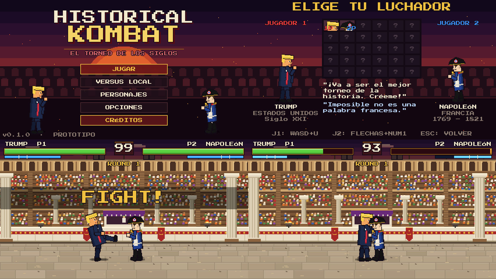

# HISTORY COMBAT — El Torneo de los Siglos



## 1. Qué es

**History Combat** es un juego de lucha arcade 2D, uno contra uno, en pixel art, donde personajes históricos de distintas épocas se enfrentan en un torneo ficticio de tono caricaturesco y exagerado. Está hecho con **Godot 4** y **GDScript**, pensado para jugarse en el **navegador** con dos jugadores en el mismo teclado.

Todo el contenido visual y sonoro de esta versión es original y se genera por código (personajes, escenario, efectos y sonidos). No se usa ningún recurso de otros juegos.

## 2. Versión actual: prototipo 0.1

Incluye:

- Menú principal (MODO HISTORIA, VERSUS LOCAL, **ENTRENAMIENTO**, DIFICULTAD, PERSONAJES, CONTROLES, CRÉDITOS).
- Selección de luchador para 2 jugadores (rejilla de 54 casillas, 50 disponibles).
- **50 luchadores** (ver lista en la sección 7), cada uno con silueta, colores, estadísticas, ataques, especiales y escenario propios. Trump y Napoleón se hicieron a mano; los otros 48 se generan con `tools/generate_fighters.py`.
- Escenario: **El Coliseo Romano** (gradas con público animado, columnas, palco imperial, braseros, suelo de piedra).
- Movimiento: caminar, saltar (vertical o con dirección), agacharse.
- 6 ataques por jugador: 2 puños, 2 patadas, 2 especiales (proyectiles, lanzador y embestida).
- Ataques agachado (barridos) y en el aire.
- Bloqueo (de pie o agachado) que reduce el daño al 15 %.
- Energía especial: los especiales la consumen y tienen tiempo de recarga.
- Hitboxes y hurtboxes con `Area2D`; cada golpe impacta una sola vez.
- Hitstop, chispas de impacto, vibración de cámara, público que se emociona, sonidos.
- Contador de combos ("3 GOLPES COMBO!").
- HUD arcade: nombres, vida con estela de daño, energía, reloj de 99 s, ronda, medallas.
- Sistema de rondas: al mejor de 3 (2 victorias), K.O., tiempo, empates.
- Pantalla de victoria con **REVANCHA**, cambiar luchador o volver al menú.
- Pausa (Esc o P).
- **Modo entrenamiento** (ver sección *Modo entrenamiento* más abajo).
- Exportación Web configurada (sin hilos, compatible con cualquier hosting estático).
- **Poder especial propio para cada luchador** (botón L / Numpad 6): muro que aplasta, oso, dragón, caballos, carabela, bombardeo, teletransporte, tiempo lento, controles invertidos, gravedad invertida... (ver sección 9).
- 202 pruebas automáticas de extremo a extremo (incluye lanzar el poder de los 30 luchadores).

## 3. Instalar y abrir el proyecto

1. Descarga **Godot 4.3** (o superior 4.x), versión estándar (no hace falta la versión .NET): https://godotengine.org/download
2. Abre Godot → **Importar** → selecciona el archivo `project.godot` de esta carpeta.
3. La primera vez Godot importará los recursos (unos segundos).

No hay dependencias externas ni plugins.

## 4. Ejecutar el juego

- En el editor, pulsa **F5** (o el botón ▶). Arranca en el menú principal.
- Para probar directamente el combate: abre `scenes/Fight.tscn` y pulsa **F6**.
- Para ver las cajas de colisión: menú **Depurar → Formas de colisión visibles**.

## 5. Controles

| Acción | Jugador 1 | Jugador 2 | J2 sin teclado numérico |
|---|---|---|---|
| Izquierda / Derecha | A / D | ← / → | ← / → |
| Saltar | W | ↑ | ↑ |
| Agacharse | S | ↓ | ↓ |
| Bloquear | Espacio | Numpad 0 | Enter |
| Puño débil | U | Numpad 1 | Supr |
| Puño fuerte | I | Numpad 2 | Fin |
| Especial 1 | O | Numpad 3 | Av Pág |
| Patada débil | J | Numpad 4 | Insert |
| Patada fuerte | K | Numpad 5 | Inicio |
| Especial 2 | L | Numpad 6 | Re Pág |
| Agarre | U + J | Numpad 1 + Numpad 4 | Supr + Insert |
| Pausa | Esc / P | Esc / P | |

- **Menús:** flechas + Enter (o ratón). Esc vuelve atrás.
- **Selección de luchador:** J1 mueve con WASD y confirma con **U** (J anula). J2 mueve con flechas y confirma con **Numpad 1** (Numpad 4 anula).
- **Correr:** doble toque (pulsar, soltar y pulsar de nuevo en menos de 0,25 s) hacia **delante** y mantener, a 1,8 veces la velocidad de caminar. Se corta al soltar, cambiar de dirección, saltar, agacharse, bloquear, atacar o recibir un golpe.
- **Backdash:** el mismo doble toque hacia **atrás** (no se corre hacia atrás). Desliza unos 55 px hacia atrás, no se le puede golpear ni agarrar los primeros 4 frames y hasta los 20 frames no puede actuar. La pantalla CONTROLES (menú o pausa) permite probarlo.
- **Saltar:** solo salta al **pulsar** la tecla (mantenerla no encadena saltos). Tarda 3 frames en despegar (preparación en el suelo) y se recuerda una pulsación hecha hasta 4 frames antes de poder saltar. Con dirección: mantener ←/→ al despegar.
- **Ataque aéreo:** atacar durante el salto; solo **uno por salto**. Si se usó, aterrizar deja 5 frames de recuperación.
- **Antiaéreo:** **abajo + puño fuerte**. Caja alta que lanza al rival por los aires y, durante sus 4 primeros frames, no le alcanzan los ataques aéreos. Deja más recuperación si falla.
- Ataque agachado: mantener abajo y atacar.
- Bloquear agachado: mantener abajo + bloqueo.
- **Combos (cancelaciones):** si un golpe **conecta o es bloqueado**, se puede cancelar pulsando otro de rango igual o mayor: débil → fuerte → especial. No se repite el mismo golpe en una cadena, no se cancela un golpe que falla y los especiales no se cancelan. Cada golpe del combo hace un 10 % menos de daño (mínimo 40 %) y acorta 2 frames el aturdimiento (mínimo 8); a un rival en el aire solo se le dan 3 golpes seguidos.
- **Combos con nombre:** cadenas concretas dan daño extra al último golpe y muestran su nombre: **TRÍO** (puño débil, puño fuerte, patada fuerte: +3) y **CUARTETO** (puño débil, patada débil, puño fuerte, patada fuerte: +5). Cada personaje puede definir los suyos en `FighterData.combos`.
- **Counter-hit:** golpear a un rival que aún está preparando su ataque (en el *startup*) hace un 20 % más de daño y 4 frames más de aturdimiento (`¡COUNTER!`).
- **Guardia:** la barra fina verde bajo la energía. Cada golpe bloqueado la gasta (2 × el daño del golpe), se recupera sola tras 1 s sin bloquear y, al llegar a 0, **se rompe**: 50 frames de aturdimiento sin poder bloquear, y vuelve al 50 %. Los golpes normales bloqueados nunca matan, pero los **especiales** (proyectiles y poderes) sí pueden rematar con su daño de rozadura. Constantes en `scripts/fighter.gd` (`GUARD_*`).
- **Altos y bajos:** los ataques aéreos son **altos** (solo se bloquean de pie), las patadas agachadas son **bajas** (solo se bloquean agachado) y el resto son **medios** (se bloquean de las dos formas). Cada `AttackData` tiene `hit_level` para dar a un golpe de pie su propio nivel (p. ej. un overhead).
- **Agarre:** puño débil + patada débil a la vez (la segunda tecla puede llegar hasta 2 frames tarde). Atraviesa el bloqueo, pero falla contra un rival en el aire, aturdido o en bloqueo forzado, y si falla deja mucho tiempo de recuperación. Si un golpe y un agarre llegan en el mismo frame, gana el golpe.
- **Derribo:** un golpe que lanza al rival por los aires, un **barrido** (patada agachado) o un **agarre** lo tiran. Al aterrizar queda **30 frames tumbado sin poder ser golpeado ni agarrado** y después se levanta. Al levantarse es invulnerable los primeros 8 de 14 frames (`KNOCKDOWN_FRAMES`, `WAKEUP_*` en `scripts/fighter.gd`). Si no actúa, se levanta en el sitio.
- **Evitar el derribo:** pulsar **bloqueo** (soltando y volviendo a pulsar) hasta 8 frames antes de tocar el suelo: se levanta al instante, con 10 frames de invulnerabilidad y sin quedar tumbado.
- **Voltereta:** manteniendo **atrás** cuando termina el derribo se levanta rodando hacia atrás (unos 80 px, 26 frames, invulnerable los primeros 16).
- **Ultimate:** **Especial 1 + Especial 2 a la vez** (la segunda tecla puede llegar hasta 2 frames tarde) con la energía al 100. Solo en el suelo. Congela el combate 48 frames con zoom sobre quien lo lanza y el nombre del ataque; después se desata **una escena de pantalla completa propia de cada luchador** (35 de daño base repartido en varios golpes, bloqueables). El ambiente se nubla u oscurece (o se sobreexpone con luz), el suelo se agrieta con fisuras brillantes, caen rayos, escombros, brasas y lluvia, y hay ondas de choque y destellos. Once tipos: bombardeo, estampida, terremoto, tormenta, luz sagrada, ondas, invocación desde los dos lados, meteoritos, lluvia de cortes en la oscuridad, trampa (un objeto gigante cae y atrapa al rival) y disparo único; cada personaje usa su dibujo (caballos, oso, dragón, corgis, legiones, barco...) y sus colores (`ULTS` en `tools/generate_fighters.py`, efectos en `scripts/ultimate_fx.gd` y `PowerEffects`). Cada ronda empieza con 30 de energía (ya no se arrastra). Prueba visual: `godot --path . res://tests/UltimateShots.tscn -- <carpeta>`.
- **CPU (`scripts/ai_controller.gd`):** además de caminar, atacar y bloquear alto/bajo, encadena cancelaciones tras un golpe que conecta, castiga ataques con recuperación larga (solo si su golpe llega a tiempo), usa el antiaéreo contra saltos cercanos, mezcla golpes bajos contra quien bloquea de pie, agarra a quien se encierra, se escapa con backdash, lanza el ultimate con la energía llena, evita el derribo pulsando bloqueo al caer y a veces se levanta con voltereta. Todo escala con el nivel de dificultad.
- **Balance de estadísticas:** la vida efectiva (vida × resistencia) va de ~84 (Hitler, *glass*) a ~114 (Xi, *tank*), como mucho 1,4 veces (antes más del doble); la fuerza compensa a los frágiles. Se define en `ARCHETYPES` de `tools/generate_fighters.py` (Trump y Napoleón se tocan a mano en su `.tres`). Los controles invertidos de Rasputín avisan 24 frames (el rival se tiñe) antes de invertirse, y los poderes de lentitud e inversión duran 2,5 s.
- **Bloqueo perfecto:** pulsar bloqueo (soltando y volviendo a pulsar) como mucho 6 frames antes de que llegue el golpe: sin daño de rozadura ni gasto de guardia, +8 de energía y 4 frames menos de bloqueo forzado (ventaja). Mantener el bloqueo no cuenta. Muestra `¡PERFECTO!`. Constantes `PERFECT_BLOCK_*` en `scripts/fighter.gd`.
- **Perfiles por personaje:** cada luchador tiene su ritmo de golpes normales según su arma y personalidad (espada/sable y lanza: más alcance y más recuperación; pesados: lentos y fuertes; veloces: cortos y rápidos; eruditos: golpes débiles y poderes fuertes), **un golpe propio alto** (overhead, solo se bloquea de pie) **o bajo** (solo se bloquea agachado) y **dos combos propios** con su nombre y bono. Los golpes altos quedan fuera de los combos (son lentos). Un combo que acaba en un especial cobra su bono aunque sea proyectil o poder. La tabla completa está en [docs/PERFILES.md](docs/PERFILES.md); se edita en `PROFILES`, `STYLE_MODS` y `TWEAKS` de `tools/generate_fighters.py`.
- **Rasgos de aspecto:** además de los colores, cada ficha puede tener silueta femenina (`female`: hombros estrechos, cintura, pestañas, labios y rubor), falda o vestido (`outfit`: skirt/dress/gown), peinados (`bob`, `braids`, `updo`, `ponytail`), tiara o cinta (`tiara`, `headband`), gafas (`glasses`), capa (`cape_color`) y joyas (`jewelry`: collar, cruz, disco en la oreja). Se asignan en `LOOKS` de `tools/generate_fighters.py`. Vista previa: `godot --path . res://tests/LookShots.tscn -- <carpeta>`.
- **Zafarse de un agarre:** pulsar puño débil + patada débil en los primeros 10 frames de la llave. Si los dos jugadores se agarran a la vez, también se zafan.
- Las teclas del jugador 2 tienen una alternativa en el bloque de navegación para portátiles sin teclado numérico.
- Algunos teclados baratos no registran muchas teclas a la vez ("ghosting"); si un jugador deja de responder al pulsar varias teclas, es una limitación del teclado.

Las acciones se llaman `p1_left`, `p1_right`, `p1_jump`, `p1_crouch`, `p1_block`, `p1_punch_light`, `p1_punch_heavy`, `p1_special_1`, `p1_kick_light`, `p1_kick_heavy`, `p1_special_2` y sus equivalentes `p2_*`. Se pueden cambiar en **Proyecto → Configuración del proyecto → Mapa de entrada**.

### Movimientos de los luchadores

| | Donald Trump | Napoleón Bonaparte |
|---|---|---|
| Puño débil (5) | Manotazo Ejecutivo | Gancho de Córcega |
| Puño fuerte (10) | Puñetazo Millonario | Directo Imperial |
| Patada débil (7) | Patada de Mocasín | Puntapié de Granadero |
| Patada fuerte (12) | Patada Inmobiliaria | Bota de Austerlitz |
| Especial 1 (15, 25 energía) | Megáfono Ensordecedor (proyectil de ondas) | Cañonazo de Artillería (bala de cañón) |
| Especial 2 (poder, 40 energía) | Muro Imparable (un muro gigante aplasta al rival) | Artillería Imperial (tres cañones disparan una ráfaga) |
| Estilo | Lento, mucha vida y resistencia | Rápido, salta más, pega algo más fuerte |

El daño real se multiplica por la `strength` del atacante y se divide por la `resistance` del defensor.

### Modo Historia (1 jugador contra la CPU)

Viaje hacia atrás en el tiempo: eliges un luchador y te enfrentas a todos los demás **del más reciente al más antiguo** (por `year` de cada ficha, nacimiento; negativo = a.C.).
- **Épocas** (`Game.STORY_CHAPTERS`): cinco *fragmentos* del tiempo roto, del más reciente al más antiguo: El mundo actual, El siglo XX, Revoluciones y progreso, Imperios y descubrimientos y La antigüedad. Cada luchador está asignado a una época; dentro de ella van por año y el jefe (`Game.STORY_BOSSES`, el más controvertido de su tiempo) va al final con +12% de vida y +5% de fuerza. Al abrir una época suena una animación propia con la voz del Nexo (`scripts/ui/story_era_intro.gd`) y después sale su tarjeta; las 3 revanchas se recuperan al empezar cada una. La partida empieza con una mini-intro del Nexo (`scripts/ui/story_prologue.gd`).
- **Línea del tiempo** (`scenes/Story.tscn`): se muestra antes de cada combate. Punto dorado = vencido, rombo = jefe de la época, "?" = el Nexo. Cada rival trae una frase de presentación (`Game.STORY_VS`, con duelos especiales en `STORY_VS_PAIR`), y el Nexo reacciona al abrir cada época según las revanchas gastadas.
- **El Nexo jugable:** al ver el **final oculto** ("liberar el tiempo") el Nexo aparece como luchador en la selección del **versus local**, con sus estadísticas normales (el refuerzo de jefe y las tres fases son solo del modo Historia). No se ofrece en el online ni en la Historia.
- **Logros y cosméticos:** el perfil tiene un botón **LOGROS** (11 logros; el servidor calcula el progreso en `GET /me/achievements` y el juego pone los nombres, `scripts/achievements.gd`; uno es oculto y sale como "???"). Ver un final del modo Historia o cumplir ciertos logros da **marcos** (color del borde del retrato) y **títulos** (bajo el nombre) que se eligen en **EDITAR PERFIL** (`scripts/cosmetics.gd`; el servidor solo deja ponerse los desbloqueados). Los demás jugadores los ven en tu perfil.
- **Desbloqueos** (`scripts/unlocks.gd`): en el modo Historia y el versus local se empieza con **12 luchadores** (`Unlocks.STARTERS`) y el resto se desbloquea **venciéndolo en el modo Historia**; los bloqueados salen como "?" en la selección. El **duelo online con ranking tiene los 50 abiertos**, para que el plantel no desnivele el ranking. También se anotan los **finales vistos** (el oculto sale como "???" en la pestaña HISTORIA del perfil). Se guarda por cuenta en el equipo (`user://unlocks.cfg`) y en el servidor (`/me/unlocks`, tabla `player_unlocks`), y solo se añade: desbloquear es para siempre.
- **Jefe final, el Nexo** (`fighters/el_nexo/`): no está en el roster, cierra la escalera con +50% de vida y +10% de fuerza, la IA al máximo y **tres fases** (a menos del 66% y del 33% de vida gana fuerza y velocidad; ver `CombatManager.NEXO_PHASES`). Se genera con `python tools/generate_fighters.py el_nexo`.
- **Final:** al vencer al Nexo habla (con voz) y se elige entre **reparar el tiempo** o **reescribirlo**; si se llegó sin gastar ninguna revancha aparece un tercer final oculto, **liberar el tiempo**. Cada decisión tiene su animación con la voz del Nexo y después se muestra el epílogo del luchador del jugador (`scripts/ui/story_ending.gd`, voces en `assets/sounds/story/end_N.wav`). Para verlo sin combatir: `godot --path . res://tests/EndingPreview.tscn -- [--ending=repair|rewrite|free] [--continues=N]`. Para ver el combate final directo: `godot --path . res://tests/NexoPreview.tscn -- [--player=id] [--stage=N]`; las animaciones de época: `res://tests/EraPreview.tscn`.
- La IA sube de nivel de forma pareja hasta +0.5 sobre la dificultad elegida.
- Al crear un luchador nuevo hay que darle `year` (el generador lo calcula de `era`).

## 6. Exportar para navegador

1. En Godot: **Editor → Gestionar plantillas de exportación → Descargar e instalar** (una sola vez).
2. **Proyecto → Exportar…** → ya existe el preset **Web** → **Exportar proyecto** → guarda como `build/web/index.html`.
3. Sube el contenido de `build/web/` a cualquier hosting estático (itch.io, GitHub Pages, Netlify…). En itch.io: sube un .zip con esos archivos y marca "This file will be played in the browser".

Para probar en local no basta con abrir `index.html` con doble clic: hay que servirlo, por ejemplo:

```bash
cd build/web
python3 -m http.server 8000
# abrir http://localhost:8000
```

El preset usa la variante **sin hilos** (`thread_support=false`), así que no necesita cabeceras especiales COOP/COEP en el servidor. Desde línea de comandos:

```bash
godot --headless --path . --export-release "Web" build/web/index.html
```

Nota: los navegadores no reproducen sonido hasta la primera pulsación del jugador; es normal.

## 7. Roster y cómo añadir personajes

Orden en la pantalla de selección: 1 Donald Trump · 2 Kim Jong-un · 3 Vladimir Putin · 4 Xi Jinping · 5 Nicolás Maduro · 6 Adolf Hitler · 7 Joseph Stalin · 8 Benito Mussolini · 9 Saddam Hussein · 10 Osama bin Laden · 11 Napoleón Bonaparte · 12 Gengis Kan · 13 Fidel Castro · 14 Cleopatra · 15 Julio César · 16 Alejandro Magno · 17 Reina Isabel II · 18 Abraham Lincoln · 19 Jesús de Nazaret · 20 Buda · 21 Papa Francisco · 22 Grigori Rasputín · 23 Pablo Escobar · 24 Albert Einstein · 25 Nikola Tesla · 26 Leonardo da Vinci · 27 Marie Curie · 28 Galileo Galilei · 29 Charles Darwin · 30 Cristóbal Colón · 31 Janequeo · 32 Lautaro · 33 Pachacútec · 34 Iván el Terrible · 35 Boudica · 36 Juana de Arco · 37 Augusto Pinochet · 38 Salvador Allende · 39 Arturo Prat · 40 Sócrates · 41 Platón · 42 Aristóteles · 43 Sun Tzu · 44 Confucio · 45 Isaac Newton · 46 Hernán Cortés · 47 Moctezuma II · 48 Nicolás Maquiavelo · 49 Mariya Oktyabrskaya · 50 Liudmila Pavlichenko.

Los nueve últimos tienen una **frase al lanzar el poder** (`power_quote` en `FighterData`, se muestra sobre su cabeza) y poderes con mecánicas nuevas: *Estado de Sitio* (Pinochet) inmoviliza al rival (`root`, no camina ni salta unos 1,7 s) y lo golpea después; *Vía Chilena* (Allende) crea un escudo de 2 s que absorbe el siguiente golpe sin daño y devuelve una onda roja; el ancla de *Abordaje de la Esmeralda* (Prat) arrastra al rival hacia él (`pull`); *Terremoto Andino* (Pachacútec) tumba al rival. Capturas: `godot --path . res://tests/NewShots.tscn -- <carpeta>`.

Los once últimos (filósofos, estrategas, científicos y soldados) tienen su **fatality caricaturesca** como ultimate, con texto propio en la pantalla PERSONAJES (`ULT_LORE` en `scripts/roster_lore.gd`): copa de cicuta, caverna de las sombras, pizarra, ejército ilusorio, estatua de Confucio, manzana gigante, flota sobre una ola, disco solar, libro *El príncipe*, cañonazo del T-34 y mira telescópica. Sus poderes: *Método Socrático* confunde al rival (`invert`); *Gravedad Absoluta* (Newton) lo deja flotando y lo estrella contra el suelo (`launch` positivo); *El Arte de la Guerra* (Sun Tzu) y *El Príncipe* (Maquiavelo) dejan una ilusión y atacan por la espalda (Maquiavelo además lo inmoviliza con un cepo); *Disparo de la Muerte* (Liudmila) ralentiza al rival antes del disparo. Escenarios en `stages/stage_defs_d.gd`.

### Generar o regenerar fichas con el script

`tools/generate_fighters.py` contiene una tabla con los personajes generados (identidad, arquetipo de estadísticas, aspecto, nombres de ataques y especiales). Se ejecuta con Python 3 (sin dependencias):

```bash
python tools/generate_fighters.py
```

Escribe `fighters/<id>/<id>.tres`. **Ojo:** sobrescribe esos archivos; si retocas un personaje a mano en Godot, quítalo de la tabla (o añade su id a `SKIP`) para que no lo pise.
Arquetipos disponibles: `balanced`, `rusher`, `bruiser`, `zoner`, `glass`, `tank`, `agile`. Tipos de especial: `P` (proyectil: `ball`, `soundwave`, `orb`, `bolt`, `spin`), `L` (lanza al rival por los aires), `D` (embestida) y `S` (golpe pesado).

### Añadir un personaje a mano

El motor no contiene datos de ningún personaje: todo está en archivos `FighterData` (`.tres`).

1. Duplica `fighters/napoleon/napoleon.tres` en una carpeta nueva, por ejemplo `fighters/cleopatra/cleopatra.tres`.
2. Ábrelo en el Inspector y edita:
   - **Identidad:** `id` (único, p. ej. `cleopatra`), nombre, nombre corto para el HUD, país, época, frase de presentación, frase de victoria y biografía.
   - **Estadísticas:** vida máxima, velocidad, salto, fuerza, resistencia.
   - **Ataques:** cada ranura (`punch_light`, `punch_heavy`, `kick_light`, `kick_heavy`, `special_1`, `special_2`, `ultimate`) es un `AttackData`. Haz clic derecho → *Hacer único* antes de editarlos para no modificar los del personaje original.
   - **Cuerpo:** ancho y alturas de la hurtbox.
   - **Aspecto provisional:** colores, peinado, sombrero y proporciones del muñeco procedural.
3. Regístralo en `scripts/fighter_registry.gd` añadiendo su ruta a `ROSTER`. Aparecerá automáticamente en la selección, en el menú PERSONAJES y en combate.

### Sustituir los gráficos provisionales por sprites

1. Crea un recurso **SpriteFrames** con estas animaciones: `idle`, `walk`, `jump`, `crouch`, `block`, `hit`, `ko`, `victory`, `sweep`, `air_kick`, `air_punch` y una por cada `anim` de los ataques (`jab`, `straight`, `kick_low`, `kick_high`, `megaphone`, `golf`, `cannon`, `charge`…). Los sprites deben mirar a la **derecha**, con los pies en el origen.
2. Asígnalo en `sprite_frames` del `FighterData` (y ajusta `sprite_offset` si hace falta).
3. El luchador ocultará el muñeco procedural y usará el `AnimatedSprite2D`. Las hitboxes no cambian: se ajustan en cada `AttackData`.
4. Para el retrato de los menús, asigna `portrait` (reservado para la siguiente versión del selector).

Los PNG pueden ir en `assets/sprites/<personaje>/`. Importa siempre con filtro **Nearest** (ya es el predeterminado del proyecto).

## 8. Añadir un escenario

1. Crea una escena cuya raíz sea un `Node2D` con el script `scripts/stage.gd` (clase `Stage`), por ejemplo `stages/versalles/Versalles.tscn`.
2. Configura en el Inspector: `display_name`, `floor_y` (altura de los pies), `left_bound` / `right_bound` (límites) y `p1_spawn_x` / `p2_spawn_x`.
3. Añade como hijos los fondos: `Sprite2D`/`TextureRect` con imágenes o nodos que dibujen por código (ver `stages/colosseum/colosseum_layer.gd`). No hacen falta colisiones: los luchadores solo usan `floor_y` y los límites.
4. Para usarlo, asigna su ruta a `Game.stage_scene` (en `scripts/autoload/game.gd`). Un selector de escenarios está pendiente.

La resolución del juego es 426 × 240.

## 9. Modificar los ataques

Cada ataque es un `AttackData` dentro del `.tres` del personaje. Todos los tiempos están en **frames a 60 fps**.

| Campo | Qué hace |
|---|---|
| `damage` | Daño base |
| `startup` / `active` / `recovery` | Preparación, frames con la hitbox activa y recuperación |
| `hitbox_offset` / `hitbox_size` | Centro y tamaño de la caja de impacto, relativa a los pies y mirando a la derecha (y negativa = arriba) |
| `crouch_offset` / `air_offset` | Desplazamiento extra de la hitbox agachado o en el aire |
| `hitstun` / `blockstun` | Frames que el rival queda aturdido al recibir / bloquear |
| `knockback` / `launch` | Empuje horizontal y lanzamiento vertical (negativo = arriba) |
| `hitstop` | Frames de congelado al impactar |
| `energy_cost` / `cooldown` | Energía que consume y frames hasta poder repetirlo |
| `dash_speed` | Avance durante el ataque (embestidas) |
| `projectile_speed` / `projectile_style` | Si es > 0, dispara un proyectil (`ball` o `soundwave`) |
| `usable_in_air` / `usable_crouching` | Dónde se puede usar |
| `anim` | Pose / animación que se reproduce |
| `effect_scale` | Tamaño de la chispa de impacto |

### Poderes especiales con efectos (`power`)

Si un `AttackData` tiene `power` (p. ej. `wall`, `bear`, `dragon`), no usa hitbox propia: al acabar su `startup` se ejecuta ese poder en `scripts/power_effects.gd`, que crea una o varias entidades (`Projectile`) con su propio dibujo (`scripts/power_art.gd`), retardo, alcance y golpes. `damage` es el daño TOTAL si todo conecta. Campos extra de `AttackData`:

| Campo | Qué hace |
|---|---|
| `power` | Identificador del poder (ver `PowerEffects.cast`) |
| `status` / `status_frames` | Estado que sufre el rival al impactar: `slow` (tiempo lento), `invert` (izquierda/derecha invertidas), `float` (flota y cae) |
| `energy_on_hit` | Energía que recupera el atacante al conectar |
| `projectile_color` | Color de los proyectiles `orb`, `bolt` y `spin` |

Para crear un poder nuevo: añade su estilo en `power_art.gd` (si necesita un dibujo nuevo), una rama `match` en `PowerEffects.cast` (las opciones se explican en la cabecera de `power_effects.gd`) y asigna su id al campo `power` del ataque. Para ver todos los poderes en combate: `godot --path . res://tests/PowerScreenshots.tscn -- <carpeta> [id1,id2,...]`.

Las constantes globales del sistema (gravedad, porcentaje de daño al bloquear, regeneración de energía, búfer de entrada) están al principio de `scripts/fighter.gd`. Las reglas de rondas y tiempo, en `scripts/autoload/game.gd`.

**Combos:** las cancelaciones están en `Fighter._try_cancel()` (rango en `CANCEL_RANK`) y el escalado, el aturdimiento decreciente, el límite de golpes en el aire y el counter-hit en `Fighter.receive_hit()`; todas las constantes están al principio de `scripts/fighter.gd` (`COMBO_*`, `HITSTUN_*`, `JUGGLE_LIMIT`, `COUNTER_*`). `scripts/combo_data.gd` define los combos con nombre: una secuencia de ranuras que deben salir **enlazadas** con cancelaciones, con un `bonus_damage` para el último golpe. Si el personaje no define `combos`, usa los comunes de `FighterData.default_combos()`.

## 10. Arquitectura

```
project.godot              Configuración, Input Map, 426x240, Compatibility
export_presets.cfg         Preset de exportación Web
scenes/
  MainMenu.tscn            Menú principal
  CharacterSelect.tscn     Selección de luchador
  Fight.tscn               Combate (CombatManager + RoundManager + HUD + pausa)
  Results.tscn             Pantalla de victoria / revancha
  fighters/Fighter.tscn    Escena genérica de luchador (Visual, Sprite, Hurtbox, Hitbox)
scripts/
  fighter.gd               Máquina de estados, física, ataques, bloqueo, energía
  fighter_data.gd          Ficha de personaje (Resource)
  attack_data.gd           Datos de un ataque (Resource)
  combo_data.gd            Combos con nombre (secuencias enlazadas con bono de daño)
  fighter_registry.gd      Lista de personajes disponibles
  fighter_renderer.gd      Pixel art procedural provisional de los luchadores
  input_manager.gd         Acciones p1_/p2_ y entradas virtuales (IA, tests)
  combat_manager.gd        Bucle de combate, empuje, impactos, efectos
  round_manager.gd         Rondas, reloj, K.O., empates, fin de partida
  ui_manager.gd            HUD arcade
  projectile.gd            Proyectiles de los especiales
  hit_effect.gd            Chispas de impacto
  stage.gd                 Clase base de escenarios
  autoload/game.gd         Estado global y cambios de escena
  autoload/sfx.gd          Efectos de sonido
  ui/                      Menú, selección, resultados, pausa, tema visual
fighters/                  Fichas .tres de cada personaje
stages/colosseum/          El Coliseo Romano
assets/                    Fuente pixel y sonidos (sprites/música: pendientes)
ui/HUD.tscn                Escena del HUD
tests/                     Pruebas automáticas y capturas
```

Estados del luchador: `IDLE`, `WALK`, `JUMP`, `CROUCH`, `BLOCK`, `ATTACK`, `HIT`, `KO` (+ `VICTORY`, `THROW`, `THROWN`, `PREJUMP`, `LAND`, `BACKDASH`, `KNOCKDOWN`, `WAKEUP`). Prioridad de entrada en el suelo: bloqueo > backdash > ataque > salto > agacharse > caminar.

### Pruebas automáticas

```bash
godot --headless --path . res://tests/TestRunner.tscn
```

Simulan pulsaciones reales de teclado y comprueban: carga de escenas y datos, Input Map sin teclas compartidas, menú → selección → combate, movimiento/salto/agacharse/bloqueo de ambos jugadores, daño exacto de los 12 ataques (un solo impacto cada uno), reducción por bloqueo, intercambio simultáneo de golpes, energía, límites de la arena, que nadie quede atascado, K.O., victoria por tiempo, empate, pantalla de victoria, revancha y 6000 frames de combate con entradas aleatorias.

Frame data de todos los ataques cuerpo a cuerpo (frame en que conectan, ventaja al golpear y al bloquear, y con qué normales enlazan). Falla si algún ataque no conecta en `startup + 1`:

```bash
godot --headless --fixed-fps 60 --path . res://tests/FrameDataTest.tscn -- [--only=napoleon,donald_trump] [--csv=user://frame_data.csv]
```

Mecánicas de combate (agarre y las que se vayan añadiendo), con entradas exactas por tick:

```bash
godot --headless --fixed-fps 60 --path . res://tests/MechanicsTest.tscn
```

En combate, **F1** recorre la capa de depuración (apagada → solo cajas → cajas y rótulos): las cajas reales de impacto (azul = cuerpo, rojo = golpe, naranja = proyectil) y, con rótulos, el estado de cada luchador, el frame del ataque (amarillo = preparación, rojo = activo, azul = recuperación) y el aturdimiento.

Modo entrenamiento (muñeco, recursos infinitos, ventaja medida y pausa de frames):

```bash
godot --headless --fixed-fps 60 --path . res://tests/TrainingTest.tscn
```

### Modo entrenamiento

Menú principal → **ENTRENAMIENTO**. Se eligen los dos luchadores como en Versus (J2 elige el muñeco). Se pelea desde el primer frame, sin reloj ni rondas; la vida (por debajo del 35 %) y la energía se rellenan solas.

| Tecla | Qué hace |
|---|---|
| **F1** | Cajas de colisión: apagadas / solo cajas / cajas y rótulos de estado |
| **F2** | Cambia la conducta del muñeco: quieto, agachado, salta, bloquea de pie, bloquea agachado, CPU o manejado por J2 |
| **F3** | Reinicia posiciones y vida |
| **F4** | Muestra u oculta el panel de frame data |
| **F5** | Pausa de frames |
| **F6** | Con la pausa de frames, avanza un solo frame |

El panel de abajo muestra el último ataque de cualquiera de los dos: nombre y ranura, **INI** (preparación), **ACT** (frames activos), **REC** (recuperación), **TOT**, el daño real (o el reducido si lo bloquean), `COUNTER` si lo fue y la **ventaja medida** al golpear (`GOLPE`) y al bloquear (`BLOQ`): cuántos frames antes que el rival puede actuar el atacante (negativa = actúa después, es decir, se le puede castigar). La ventaja aparece como `?` hasta que se mide: haz el ataque contra el muñeco quieto y luego contra el que bloquea. Con dos o más golpes seguidos se ve también el daño total del combo.

Capturas de pantalla (necesita pantalla o `xvfb-run`): `godot --path . res://tests/ScreenshotRunner.tscn -- <carpeta>`.

### Duelo online

Menú principal → **DUELO ONLINE** → eliges luchador → *buscando rival* → pelea. Cada jugador usa **su** teclado como J1 (WASD + U/I/J/K/O/L); el servidor decide quién es P1 y quién P2. No hay que abrir puertos ni configurar nada: los dos se conectan al servidor.

- **Servidor:** carpeta `server/` (Fastify + WebSocket, ver `server/README.md`). Solo empareja y reenvía botones; no simula la pelea. Swagger en `/docs`.
- **Cliente:** `scripts/autoload/online.gd` (conexión y cola), `scripts/lockstep_session.gd` (sincronización) y `scripts/ui/online_lobby.gd` (pantalla de espera).
- **Sincronización (lockstep):** cada PC simula la pelea entera y solo se envían los botones de cada tick. Un botón se aplica 4 ticks (66 ms) después de pulsarlo, en los dos PC; si el rival aún no llegó, el combate espera ("ESPERANDO AL RIVAL..."). Funciona porque la simulación es determinista (`tests/determinism_test.gd`): **no uses azar (`randf`) en la lógica del combate**, solo en efectos visuales.
- **Servicios en Railway** (se despliegan desde GitHub Actions, cada uno con su Dockerfile): `server/` (partidas, WebSocket), `web/` (entrega el juego exportado a Web) y Postgres. El servicio `web` tiene la variable `SERVER_URL` (`wss://<dominio-del-server>/ws`) y la publica en `/config.js`, que el juego lee en el navegador; así el mismo build sirve en `develop` y en producción.
- **Dirección del servidor (Godot/.exe):** `scripts/autoload/online_config.gd` (debug → `ws://localhost:8787/ws`; release → producción) o `user://online.cfg` con `[server] url="..."` para forzar otra (p. ej. la de develop).
- **Entornos:**
  | Entorno | Rama | Dónde | Dominio |
  |---|---|---|---|
  | local | cualquiera | `npm run dev:local` en `server/` (PGlite) + Godot F5 | `localhost:8787` |
  | develop | `develop` | Railway, entorno `develop` (Postgres propio y vacío) | solo los `*.up.railway.app` por defecto |
  | producción | `main` | Railway, entorno `production` | `historycombat.cl` (solo producción) |

  Flujo: rama de feature → PR a `develop` → PR de `develop` a `main`. Un push a `develop` o `main` despliega a su entorno (CI).
- **Probar en local:** `cd server && npm install && npm run dev`, y abrir el juego dos veces (dos instancias de Godot o dos pestañas).
- **Pruebas:** `godot --headless --fixed-fps 60 --path . res://tests/OnlineTest.tscn` (dos PC simulados con lag), `GODOT=godot bash tests/run_online_e2e.sh` (servidor real + dos clientes), `tests/run_account_e2e.sh` (cuentas) y `tests/run_ranked_e2e.sh` (duelo con puntos entre dos cuentas). Los dos últimos usan el servidor de desarrollo con base de datos embebida, sin Postgres.
- **Probar con cuentas en tu PC:** `cd server && npm install && npm run dev:local` (Postgres embebido en `server/.dev-data/`), y abrir el juego. Sin esto, o con el servidor apagado, el juego salta el login y funciona offline.

### Cuentas, perfil y ranking

- **Cuentas en tu servidor con Postgres** (no hay Supabase): `scripts/autoload/backend.gd` habla con `/auth/*`, `/me` (también `PATCH` para elegir el **avatar**, un luchador que sale como retrato en el **PERFIL**), `/me/matches` y `/leaderboard`. La sesión se recuerda (refresh token en `user://`) y se renueva sola. **Partida del modo Historia:** se guarda sola al empezar, al ganar cada combate y al perder (descuenta la revancha), en la tabla `story_saves` de la cuenta (`/me/story`) y como copia local (`user://story_save.cfg`); el menú muestra **CONTINUAR HISTORIA** y se queda con la más reciente, así que se puede seguir tras recargar la página o desde otro PC. Se borra al elegir el final o al quedarse sin revanchas. Sin sesión solo existe la copia local.
- **Pantallas:** `login.gd` (entrar / crear cuenta / jugar sin cuenta), `profile.gd` (puntos, victorias, derrotas y últimos duelos), `ranking.gd` y los botones RANKING / PERFIL del menú.
- **Duelo con ranking:** si los dos jugadores tienen cuenta, el resultado cuenta. Al terminar, `results.gd` reporta el resultado y espera a que el servidor confirme los puntos (`+16 PUNTOS`, `TOTAL 1016`). Contra un invitado el duelo es amistoso. Reglas completas en `server/README.md`.
- **Limitaciones actuales:** sin revancha online (se vuelve al menú), sin detección de desincronización en vivo, sin pausa online (ESC solo permite abandonar). Si un jugador abandona, el otro gana la partida.

## 11. Pendiente para próximas versiones

- Equilibrar a los 30 luchadores con partidas reales (las estadísticas actuales son una primera propuesta por arquetipo).
- Sprites definitivos dibujados a mano y retratos (el sistema ya los admite).
- Ataque definitivo (los datos ya existen en cada ficha; falta asignarle entrada y animación).
- Retocar con partidas reales los perfiles de cada luchador (ver `docs/PERFILES.md`).
- Movimientos especiales con secuencias de joystick (↓↘→ + botón).
- Agarres / llaves.
- Más escenarios y selector de escenario.
- Menú de opciones: reasignar teclas, volumen, número de rondas y tiempo.
- Música.
- Soporte de mandos y controles táctiles para móvil.
- Online: revancha, detección de desincronización y recuperar la contraseña por email.

---

Parodia de ficción. Los personajes son caricaturas de figuras históricas y públicas; ninguno ha participado ni respaldado este juego.
Fuente "Press Start 2P" © CodeMan38, licencia SIL Open Font License (`assets/fonts/OFL_PressStart2P.txt`).
