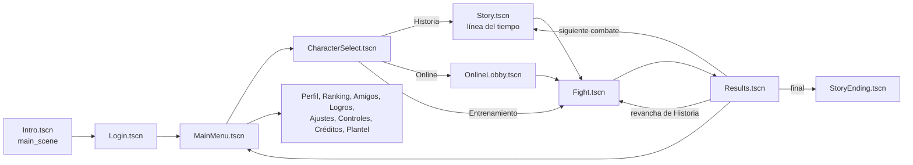
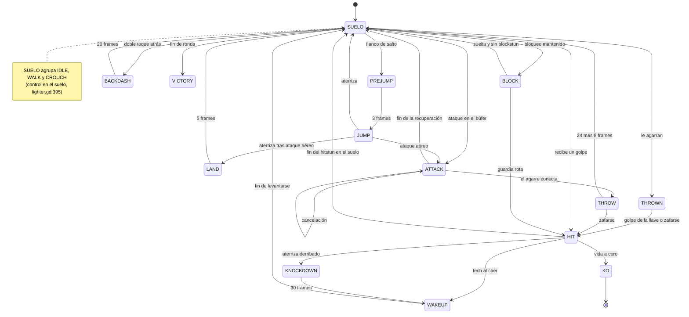
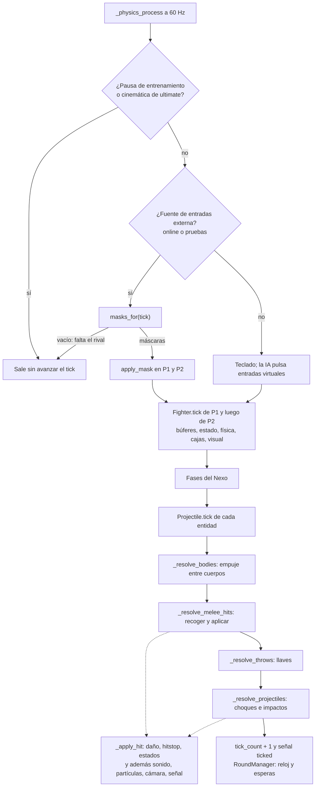
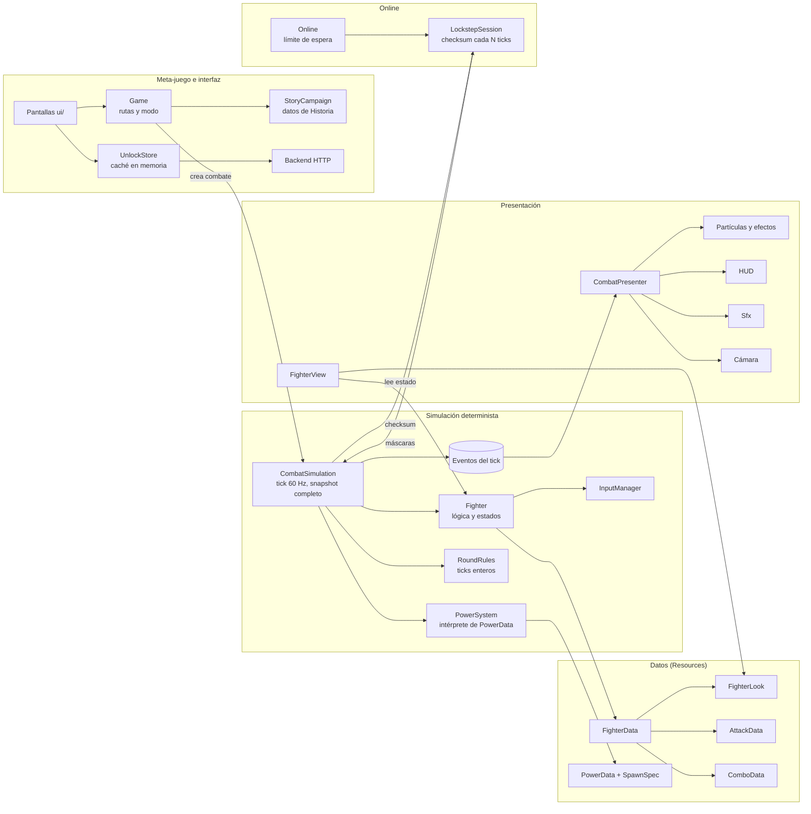
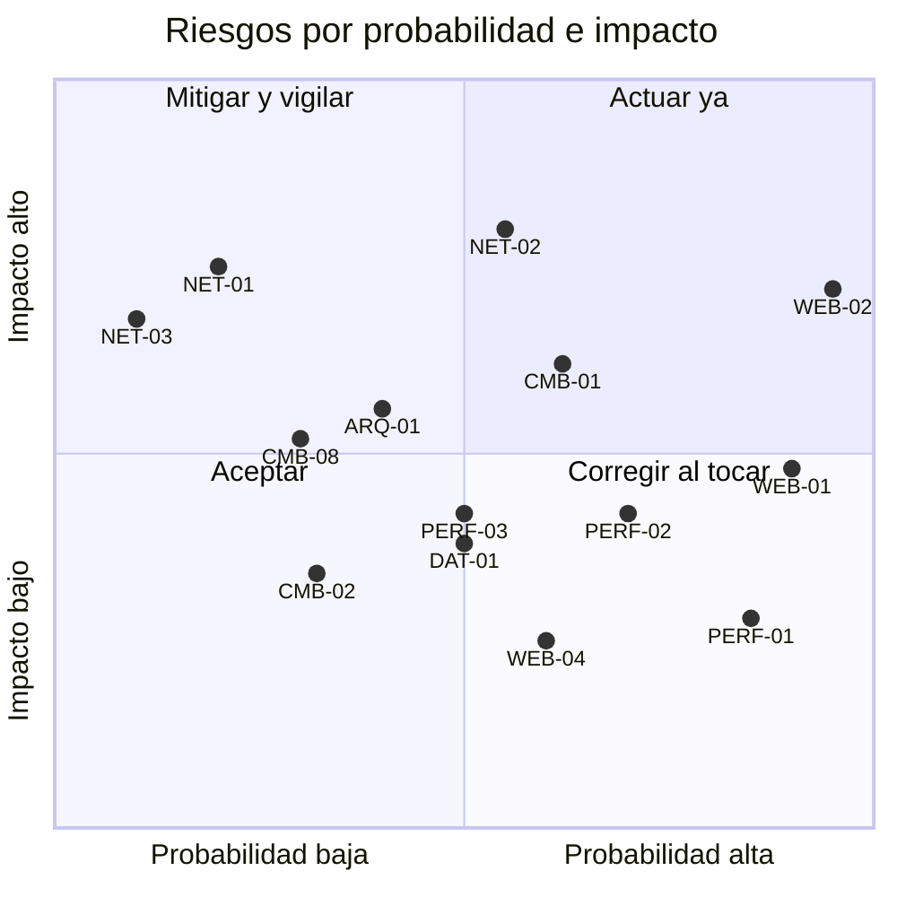

# Auditoría técnica — History Combat

**Fecha:** 3 de noviembre de 2026 · **Repositorio:** rama `develop`, commit `0de6464` · **Tipo:** auditoría de solo lectura (no se modificó ningún archivo del proyecto).

**Cómo leer este informe.** Cada hallazgo lleva un identificador (`ARQ-`, `CMB-`, `NET-`, `PERF-`, `WEB-`, `DAT-`, `QA-`, `TST-`) y una de estas etiquetas:

- **PROBLEMA CONFIRMADO**: hay evidencia directa en el código o en un archivo medido.
- **RIESGO POTENCIAL**: el código permite el problema, pero no se ha comprobado que ocurra.
- **PENDIENTE DE VALIDACIÓN**: hace falta ejecutar, medir o probar en un navegador o dispositivo concreto.

**Límites del análisis.** No se ejecutó el juego, ni la suite de pruebas, ni un perfilador. Las únicas cifras medidas son tamaños de archivo y recuentos de líneas. Cualquier otro número de rendimiento es una estimación y así se indica. Las referencias tienen la forma `ruta:línea` relativas a la raíz del repositorio.

---

## 1. Resumen ejecutivo

El proyecto tiene una arquitectura adecuada a su tamaño y **no necesita una reescritura**. La simulación de combate es determinista por diseño, los personajes se definen con Resources y existe una batería de pruebas automáticas en CI que incluye frame data, mecánicas, determinismo y online con servidor real.

**No se encontraron hallazgos de severidad CRÍTICA.** Los más importantes:

| Prioridad | ID | Hallazgo | Severidad | Etiqueta |
|---|---|---|---|---|
| 1 | CMB-01 | Las fases del jefe final (el Nexo) modifican una ficha compartida y el refuerzo se acumula en cada revancha perdida | ALTO | PROBLEMA CONFIRMADO (análisis estático) |
| 2 | NET-02 | Un duelo online puede quedar congelado sin límite si un jugador oculta la pestaña o deja de enviar entradas | ALTO | RIESGO POTENCIAL |
| 3 | CMB-02 | En un intercambio simultáneo, el barrido del segundo jugador procesado no derriba: el resultado depende del orden P1/P2 | MEDIO | PROBLEMA CONFIRMADO (análisis estático) |
| 4 | NET-01 | No hay detección de desincronización en el online, aunque `state_checksum()` ya existe | MEDIO | PROBLEMA CONFIRMADO |
| 5 | PERF-01, PERF-02, PERF-03, WEB-01 | Coste en navegador: relecturas de disco en la selección, redibujo continuo sin tope de FPS, MSAA 4x y un `.wasm` de 39,5 MB (8,0 MB con brotli) | MEDIO | Mezcla de CONFIRMADO y PENDIENTE |
| 6 | WEB-02 | Sin controles táctiles ni mando en combate: el juego no es jugable en móviles | ALTO (alcance) | PROBLEMA CONFIRMADO |

**Recomendación general.** Primero, los arreglos pequeños y de bajo riesgo (CMB-01, CMB-02, PERF-01, límite de espera online). Después, dos refactorizaciones incrementales protegidas con pruebas de checksum: separar simulación y presentación en `CombatManager`, y pasar los parámetros de los poderes de código a datos.

---

## 2. Descripción del proyecto

History Combat es un juego de lucha 2D uno contra uno, en pixel art procedural, pensado para el navegador. Tiene modo Historia contra la CPU, entrenamiento y duelo online con cuentas, ranking, temporadas, amigos y logros.

### 2.1 Ficha técnica

| Aspecto | Valor | Evidencia |
|---|---|---|
| Motor | Godot **4.7**, renderer Compatibility | `project.godot:21` (`config/features=("4.7", "GL Compatibility")`), `.github/workflows/ci.yml` (`GODOT_VERSION: "4.7-stable"`) |
| Lenguaje del cliente | GDScript (≈19.400 líneas en `scripts/` y `stages/`, ≈4.500 en `tests/`) | `wc -l` |
| Otros lenguajes | TypeScript en `server/` (≈3.800 líneas) y `web/`; Python en `tools/` (≈2.100 líneas) | `wc -l` |
| Renderizado | `gl_compatibility` en escritorio y móvil (WebGL 2 en web) | `project.godot:185-186` |
| Resolución | 426×240 lógica, ventana 1278×720, `stretch/mode="canvas_items"`, filtro *nearest*, **MSAA 2D = 2 (4x)** | `project.godot:35-39, 184, 187` |
| Física | El combate no usa el motor de física: cajas AABB calculadas a mano. `physics_jitter_fix=0.0`. Tasa de física por defecto (60 Hz) | `project.godot:180`, `scripts/fighter.gd:246-257` |
| Audio | Un único bus (no hay `default_bus_layout.tres`). 12 efectos WAV sin comprimir, 20 voces WAV comprimidas (`compress/mode=2`), 1 música OGG en streaming. Pool de 8 `AudioStreamPlayer` | `assets/**/*.import`, `scripts/autoload/sfx.gd` |
| Entrada | 23 acciones (`p1_*`, `p2_*` × 11 y `pause`), solo teclado por `physical_keycode`. Sin acciones de mando ni táctiles | `project.godot` sección `[input]` |
| Autoloads | `Game`, `Sfx`, `Backend`, `Online` | `project.godot:28-31` |
| Plugins | Ninguno (no existe `addons/`) | listado del repositorio |
| Exportación | Un solo preset, **Web**: sin hilos, sin extensiones, PWA desactivada, carga `config.js` | `export_presets.cfg:9-33` |
| Servicios externos | `server/` (Fastify + WebSocket + Postgres o PGlite, en Railway), `web/` (Fastify estático con precompresión), Google Sign-In vía `JavaScriptBridge` | `server/`, `web/`, `scripts/google_sign_in.gd` |
| Contenido | 50 luchadores + jefe final, un escenario procedural por luchador y el Coliseo. No hay texturas de personajes: todo se dibuja con `_draw()` | `fighters/`, `stages/`, `scripts/fighter_renderer.gd` |

### 2.2 Punto de entrada y flujo de escenas

1. Se inicializan los autoloads. `Sfx._ready` carga los ajustes de volumen y precarga los 12 sonidos (`scripts/autoload/sfx.gd`).
2. Escena principal: `scenes/Intro.tscn` (`project.godot:20`), que arranca música y voces y pasa a `Login.tscn` (`scripts/ui/intro_screen.gd:177`).
3. `Login.tscn` restaura la sesión o permite jugar sin cuenta y va a `MainMenu.tscn` (`scripts/ui/login.gd:51`).
4. Desde el menú: `CharacterSelect` → `Story` (Historia) u `OnlineLobby` (online) → `Fight.tscn` → `Results.tscn`.
5. Los cambios de escena pasan por `Game.goto()` con fundido y `change_scene_to_file` síncrono (`scripts/autoload/game.gd:283-304`).

### 2.3 Estructura de carpetas

| Carpeta | Contenido |
|---|---|
| `scenes/` | 20 escenas de pantalla y `fighters/Fighter.tscn`. Casi todas tienen solo el nodo raíz y su script: la interfaz se construye en código |
| `scripts/` | Núcleo de combate, presentación, IA, red, datos y `ui/` (25 pantallas) |
| `scripts/autoload/` | `game.gd`, `sfx.gd`, `backend.gd`, `online.gd` y configuración de servidor |
| `stages/` | Coliseo (escena propia) y escenarios temáticos definidos como listas de operaciones de dibujo (`stage_defs_a..d.gd`, `stage_ops.gd`) |
| `fighters/` | 51 fichas `.tres` (`FighterData` con `AttackData` y `ComboData` embebidos) |
| `assets/` | Fuente Press Start 2P, sonidos, voces y música (7,5 MB en total) |
| `tests/` | 25 escenas de prueba o captura y 4 scripts de extremo a extremo |
| `tools/` | Generadores en Python: fichas de luchadores, música y voces |
| `server/`, `web/` | Backend y servidor web (ambos con `.gdignore`) |

---

## 3. Inventario de arquitectura actual

### 3.1 Autoloads

| Autoload | Archivo (líneas) | Responsabilidades |
|---|---|---|
| `Game` | `scripts/autoload/game.gd` (514) | Rutas de escena y fundidos; modo de juego y dificultad; reglas y contenido del modo Historia (épocas, jefes, frases); refuerzo de jefes; estado de retos; filtros del ranking; propósito del selector de avatar; nivel de sangre |
| `Sfx` | `scripts/autoload/sfx.gd` (49) | Pool de 8 reproductores; carga de ajustes de audio al arrancar |
| `Backend` | `scripts/autoload/backend.gd` (552) | Cliente HTTP de cuentas, perfil, ranking, amigos, retos, temporadas, partida guardada y desbloqueos; sesión en `user://` |
| `Online` | `scripts/autoload/online.gd` (241) | WebSocket, cola de emparejamiento, reparto de entradas por tick, resultado del duelo |

### 3.2 Núcleo de combate (simulación)

| Módulo | Archivo (líneas) | Responsabilidad |
|---|---|---|
| `CombatManager` | `scripts/combat_manager.gd` (607) | Raíz de `Fight.tscn`. Bucle a 60 Hz, orden fijo de actualización, empuje entre cuerpos, resolución de impactos, llaves y proyectiles. También efectos, sonido, cámara, cinemática del ultimate, fases del Nexo y la etiqueta de espera online |
| `Fighter` | `scripts/fighter.gd` (1239; 67 variables, 66 funciones) | Máquina de 16 estados, física, búferes de entrada, ataques y cancelaciones, combos, guardia, agarres, derribos, estados alterados, cajas de colisión y empuje del estado al renderizador |
| `RoundManager` | `scripts/round_manager.gd` (165) | Rondas, reloj por ticks, K.O., empates, fin de partida y cambio de escenario entre rondas |
| `InputManager` | `scripts/input_manager.gd` (104) | Abstracción de entrada: teclado, entradas virtuales (IA y pruebas) y máscaras de bits (red y repeticiones) |
| `Projectile` | `scripts/projectile.gd` (272) | Proyectiles, entidades de poder y elementos solo visuales; movimiento, armado, golpes repetidos, dibujo |
| `PowerEffects` | `scripts/power_effects.gd` (659) | Catálogo estático de ≈45 poderes y 11 tipos de ultimate: crea entidades con parámetros literales |
| `AIController` | `scripts/ai_controller.gd` (378) | CPU que pulsa entradas virtuales, con `RandomNumberGenerator` propio |
| `TrainingMode` | `scripts/training_mode.gd` (285) | Muñeco, recarga de vida, panel de frame data, pausa y avance de frames |
| `LockstepSession` | `scripts/lockstep_session.gd` (125) | Lockstep con retraso de entrada adaptativo; sin dependencia de la red (se prueba sin conexión) |

### 3.3 Presentación

| Módulo | Archivo (líneas) | Responsabilidad |
|---|---|---|
| `FighterRenderer` | `scripts/fighter_renderer.gd` (1010) | Muñeco articulado procedural con poses por diccionarios de ángulos |
| `PowerArt` | `scripts/power_art.gd` (995) | Dibujo procedural de ≈60 estilos de poder |
| `UltimateFX` | `scripts/ultimate_fx.gd` (272) | Ambiente, grietas, rayos y partículas de los ultimates (hasta 220 partículas) |
| `ParticleFX` | `scripts/particle_fx.gd` (225) | Polvo, chispas, sangre y destello (hasta 30 partículas) |
| `HitEffect` | `scripts/hit_effect.gd` (63) | Chispa de impacto que se autodestruye |
| `HUD` | `scripts/ui_manager.gd` (311) | Barras, reloj, mensajes y combos dibujados con `_draw()` |
| `DebugOverlay` | `scripts/debug_overlay.gd` (89) | Dibuja las mismas cajas que usa el motor (F1) |
| Escenarios | `stages/stage_ops.gd` (1091), `stage_defs_a..d.gd` (≈1.280), `themed_layer.gd`, `colosseum_layer.gd` | Operaciones de dibujo y definiciones por luchador |

### 3.4 Datos

| Módulo | Archivo | Responsabilidad |
|---|---|---|
| `FighterData` | `scripts/fighter_data.gd` (200) | Ficha: identidad, estadísticas, 8 ranuras de ataque, combos, cuerpo y más de 40 campos de aspecto procedural |
| `AttackData` | `scripts/attack_data.gd` (106) | 36 campos exportados que cubren golpes, proyectiles, poderes, agarres y ultimates |
| `ComboData` | `scripts/combo_data.gd` (37) | Secuencia de ranuras enlazadas y bono de daño |
| `FighterRegistry` | `scripts/fighter_registry.gd` (112) | Lista explícita del plantel, caché y validación |
| `StageRegistry` | `stages/stage_registry.gd` (39) | Busca la definición del escenario en `StageDefsA..D` |
| Contenido narrativo | `game.gd:60-167`, `scripts/roster_lore.gd` (352) | Épocas, jefes, frases de presentación, textos de ultimates |

### 3.5 Meta-juego e interfaz

`scripts/unlocks.gd`, `cosmetics.gd`, `achievements.gd`, `season.gd`, `settings.gd`, `google_sign_in.gd` y 25 pantallas en `scripts/ui/` (`main_menu`, `character_select`, `results`, `ranking`, `profile`, `friends`, `story_*`, `intro_screen`, etc.). Las pantallas se dibujan con `_draw()` sobre nodos creados en código.

---

## 4. Diagrama de arquitectura actual

### 4.1 Módulos y dependencias

```mermaid
flowchart LR
    subgraph AUTO["Autoloads (estado global)"]
        GAME["Game<br/>escenas, modo, Historia, retos, filtros"]
        SFX["Sfx<br/>pool de audio"]
        BACK["Backend<br/>HTTP cuentas"]
        ONL["Online<br/>WebSocket"]
    end

    subgraph FIGHT["Fight.tscn"]
        CM["CombatManager<br/>bucle 60 Hz + efectos + cámara"]
        RM["RoundManager<br/>rondas y reloj"]
        HUD["HUD<br/>ui_manager.gd"]
        F1["Fighter P1"]
        F2["Fighter P2"]
        PRJ["Projectiles"]
        PFX["ParticleFX / HitEffect / UltimateFX"]
        STG["Stage / ThemedStage"]
        AI["AIController"]
        TM["TrainingMode"]
    end

    subgraph DATA["Datos"]
        FD["FighterData .tres"]
        AD["AttackData"]
        CD["ComboData"]
        REG["FighterRegistry"]
        SREG["StageRegistry + StageDefsA..D"]
    end

    PE["PowerEffects (estático)"]
    PA["PowerArt (estático)"]
    LS["LockstepSession"]
    IM["InputManager"]
    UNL["Unlocks (estático)"]
    REN["FighterRenderer"]

    GAME -->|"p1_data / p2_data"| CM
    CM --> F1 & F2
    CM --> PRJ
    CM -->|"set_input_source"| ONL
    ONL --> LS
    LS --> IM
    F1 & F2 --> IM
    F1 & F2 -->|"señales"| CM
    F1 & F2 --> REN
    CM --> PE
    PE -->|"accede a internos de cm"| CM
    PE --> PRJ
    PRJ --> PA
    PRJ -->|"get_parent().get_parent()"| CM
    CM --> PFX
    CM --> SFX
    CM --> HUD
    CM --> STG
    RM -->|"llamadas directas a hud"| HUD
    RM --> GAME
    CM --> AI
    CM --> TM
    REG --> FD
    FD --> AD & CD
    STG --> SREG
    UNL --> BACK
    BACK --> UNL
```



Lectura: la dependencia `CombatManager ↔ PowerEffects` es circular (PowerEffects llama incluso al método privado `cm._start_ult_fx`, `scripts/power_effects.gd:423`), igual que `Backend ↔ Unlocks` (`scripts/autoload/backend.gd:214-226`, `scripts/unlocks.gd:38-47`). La simulación (`CombatManager`, `Fighter`) llama directamente a presentación (`Sfx`, `HUD`, `ParticleFX`, `FighterRenderer`).

### 4.2 Flujo de escenas



---

## 5. Auditoría de arquitectura

### 5.1 Modularidad

**Lo que funciona bien**

- La entrada está bien aislada: `Fighter` nunca lee el teclado, solo su `InputManager` (`scripts/input_manager.gd:1-5`). El mismo camino sirve para teclado, IA, pruebas y red.
- `LockstepSession` no conoce la red: recibe funciones para leer, enviar y medir el tiempo (`scripts/lockstep_session.gd:58-62`), lo que permite probarla con lag simulado (`tests/online_test.gd`).
- `Fighter` avisa al `CombatManager` por señales (`projectile_requested`, `power_requested`, `attack_started`, `knocked_out`) y no tiene referencia a él.
- Los datos de personaje viven en Resources y el motor no contiene números de ningún luchador concreto.

**Problemas**

| ID | Hallazgo | Evidencia | Etiqueta |
|---|---|---|---|
| ARQ-01 | `CombatManager` mezcla simulación determinista con presentación: en el mismo tick decide impactos y reproduce sonidos, crea partículas, mueve la cámara con `randf_range`, excita al público y muestra mensajes | `scripts/combat_manager.gd:156-189, 426-488, 601-607` | PROBLEMA CONFIRMADO |
| ARQ-02 | `Fighter` concentra demasiadas responsabilidades (ver 3.2): 1239 líneas, 67 variables de estado | `scripts/fighter.gd` | PROBLEMA CONFIRMADO |
| ARQ-03 | `Game` es un objeto global con responsabilidades no relacionadas: rutas, reglas y contenido de Historia, retos, filtros de ranking, selector de avatar y sangre | `scripts/autoload/game.gd:7-514` | PROBLEMA CONFIRMADO |
| ARQ-06 | Dependencia circular `CombatManager ↔ PowerEffects` con acceso a internos (`cm.projectiles_root`, `cm.fx`, `cm.ult_fx`, `cm._start_ult_fx`) | `scripts/power_effects.gd:419-423, 623-659` | PROBLEMA CONFIRMADO |
| ARQ-07 | `Projectile` localiza al `CombatManager` subiendo dos niveles en el árbol | `scripts/projectile.gd:177` | PROBLEMA CONFIRMADO (frágil ante cambios de jerarquía) |
| ARQ-08 | `PowerEffects` escribe directamente el estado interno del luchador: posición (teletransportes), orientación, velocidad y escudo | `scripts/power_effects.gd:86-96, 149, 215, 262, 306-317, 355-363` | PROBLEMA CONFIRMADO |

### 5.2 Principios SOLID

| Principio | Violación real | Evidencia | Impacto |
|---|---|---|---|
| Responsabilidad única | `CombatManager`, `Fighter` y `Game` (ARQ-01 a ARQ-03) | ver 5.1 | Cambios de efectos visuales tocan el archivo de la simulación; mayor riesgo de romper el determinismo del online |
| Abierto/cerrado | Añadir un poder exige una rama nueva en `PowerEffects.cast` (≈45 ramas) y en `PowerArt.draw`. Añadir un luchador exige tocar entre 6 y 9 sitios (ARQ-04) | `scripts/power_effects.gd:35-393`, `scripts/power_art.gd:14-80` | El coste de cada luchador nuevo crece y es fácil olvidar un paso. Si falta en `Game.STORY_CHAPTERS`, cae en silencio en la última época (`game.gd:448-452`) |
| Sustitución de Liskov | `CombatManager` comprueba el subtipo concreto (`if stage is ThemedStage`) y le asigna `fighter_id` antes de añadirlo al árbol | `scripts/combat_manager.gd:95-96` | Leve: un tercer tipo de escenario necesitaría otra comprobación |
| Segregación de interfaces | `AttackData` tiene 36 campos para cinco tipos de ataque distintos; `FighterData` mezcla estadísticas con más de 40 campos del renderizador provisional | `scripts/attack_data.gd`, `scripts/fighter_data.gd:72-123` | Inspector ruidoso; cuando lleguen sprites definitivos, cada ficha seguirá arrastrando datos de aspecto que ya no se usan |
| Inversión de dependencias | `Fighter` depende del tipo concreto `FighterRenderer` (`@onready var visual: FighterRenderer`) y la simulación llama a autoloads concretos (`Sfx`, `Game`, `HKTheme`). Ejemplo positivo: la fuente de entrada se inyecta con `set_input_source(Callable)` | `scripts/fighter.gd:140, 976, 1023`; `scripts/combat_manager.gd:219-222` | Más difícil simular sin escena ni audio; acoplamiento a una implementación visual |

### 5.3 Comunicación entre componentes

| Mecanismo | Uso actual | Valoración |
|---|---|---|
| Señales | Luchador → combate; combate → HUD y entrenamiento (`hit_landed`); combate → reloj (`ticked`); `Online` → combate (`CONNECT_ONE_SHOT`) | Bien usadas. Siete señales se emiten sin ningún oyente en producción: `guard_broken`, `energy_changed`, `shield_absorbed`, `Stage.excited`, `round_started`, `round_finished`, `match_finished` (ARQ-09, PROBLEMA CONFIRMADO, bajo) |
| Llamadas directas | `RoundManager` llama a `combat.hud.show_message()` y `combat.set_controls()`; `CombatManager` llama a `hud`, `stage.excite()`, `camera` | Aceptable dentro de una escena, pero acopla reglas de ronda con textos de HUD (`scripts/round_manager.gd:60-67, 113-125`) |
| Autoloads como estado global | `Game.mode` se consulta dentro del tick del reloj (`round_manager.gd:75`); `Online.stalled_ticks` dentro del combate (`combat_manager.gd:250`) | Dependencias ocultas: el comportamiento del combate depende de estado global que no forma parte de su snapshot |
| Callables | `set_input_source` y las funciones de `LockstepSession` | Buen desacoplamiento |
| Acceso por jerarquía | `get_parent().get_parent()` en proyectiles | Frágil (ARQ-07) |

### 5.4 Gestión de escenas

- `Fight.tscn` es mínima (34 líneas). Los nodos de combate se crean en código: luchadores, `DebugOverlay`, `AIController`, `TrainingMode`, `ParticleFX`, etiqueta de espera online, capas de escenario, proyectiles y efectos. Es coherente, pero el editor no muestra la composición real.
- Las pantallas de interfaz son escenas de 12 líneas con el script en la raíz; todo se dibuja en `_draw()`. Ventaja: control exacto del píxel. Coste: no hay vista previa en el editor y el diseño de la interfaz vive en código.
- Instanciación: `Fighter.tscn` se precarga (`combat_manager.gd:16`); el escenario se carga con `load()` síncrono al empezar y al cambiar de ronda (`combat_manager.gd:87-112`). Los escenarios son ligeros porque se dibujan por código.
- Destrucción: proyectiles, efectos y peticiones HTTP se liberan con `queue_free()`. Las cachés estáticas se vacían en `Game._exit_tree` (`game.gd:211-215`). No se encontraron fugas por análisis estático (ver 7.3).
- Carga y descarga de recursos: no hay carga en segundo plano ni descarga explícita; con el tamaño actual de recursos (PCK de 3,3 MB) no es necesario.

---

## 6. Auditoría del sistema de combate

### 6.1 Control de personajes

| Elemento | Implementación | Evidencia | Valoración |
|---|---|---|---|
| Bucle | `CombatManager._physics_process` actualiza P1 y luego P2 con `tick(delta)` | `combat_manager.gd:156-189` | Orden fijo, bueno para el determinismo |
| Movimiento | Caminar (retroceso ×0,8), correr con doble toque (×1,8), backdash | `fighter.gd:395-440, 461-478` | Correcto |
| Salto | Solo con el flanco de la tecla, 3 frames de preparación, búfer de 4 frames, recuperación de 5 tras ataque aéreo | `fighter.gd:449-455, 498-508` | Correcto |
| Orientación | Solo se gira en estados neutros y en el suelo | `fighter.gd:1125-1131` | Correcto |
| Prioridad de acciones en el suelo | bloqueo > backdash > ataque > salto > agacharse > caminar | `fighter.gd:409` | Documentada en código y README |
| Búfer de ataque | 6 frames; no corre durante el hitstop | `fighter.gd:669-685` | Bueno: permite cancelar en el hitstop |
| Pulsaciones simultáneas | `pressed_attack()` devuelve la primera del array fijo; salvo agarre y ultimate, gana puño débil > puño fuerte > especial 1 > patada débil… | `input_manager.gd:46-50` | CMB-05, decisión no documentada (bajo) |
| Cancelaciones | Solo si el golpe conectó o fue bloqueado, rango igual o mayor, sin repetir ranura, nunca desde especiales | `fighter.gd:723-732` | Reglas claras |
| Animación | La lógica empuja pose y fase al renderizador; la lógica no depende de la animación | `fighter.gd:1207-1235` | Bien desacoplado (ver 6.3) |

### 6.2 Sistema de ataques

| Mecánica | Dónde | Notas |
|---|---|---|
| Daño | `daño × fuerza del atacante / resistencia del defensor` | `fighter.gd:960` |
| Bloqueo | 15 % de daño; los normales nunca matan, los especiales sí | `fighter.gd:961-985` |
| Guardia | Se gasta 2× el daño bloqueado, se regenera tras 60 frames, se rompe con 50 frames de aturdimiento | `fighter.gd:42-47, 386-390, 1032-1038` |
| Bloqueo perfecto | Pulsación ≤ 6 frames antes del golpe | `fighter.gd:965-975` |
| Counter-hit | Golpe durante el startup del rival: ×1,2 de daño y +4 de hitstun | `fighter.gd:990-994` |
| Escalado de combo | −10 % por golpe (mínimo 40 %), −2 frames de hitstun por golpe (mínimo 8), máximo 3 golpes en el aire | `fighter.gd:53-57, 995, 1018-1019` |
| Knockback y lanzamiento | Velocidades en `AttackData`; rebote del atacante en la esquina | `fighter.gd:1008-1017`, `combat_manager.gd:452-453` |
| Derribo, levantarse y tech | 30 frames tumbado, levantarse con invulnerabilidad, voltereta, evitar el derribo pulsando bloqueo | `fighter.gd:91-99, 597-638` |
| Agarre | Puño débil + patada débil, ventana de 10 frames para zafarse | `fighter.gd:126-136, 642-664`, `combat_manager.gd:353-384` |
| Invulnerabilidad | Por condiciones en `can_be_hit()` (backdash, levantarse, tumbado, llave) y antiaéreo frente a ataques aéreos | `fighter.gd:833-835, 889-896` |
| Coste y enfriamiento | `energy_cost` y `cooldown` por ataque | `fighter.gd:743-753` |
| Impactos | Primero se recogen todos y después se aplican, para que un intercambio afecte a los dos | `combat_manager.gd:327-362` |

**Hallazgos**

- **CMB-01 · Refuerzo acumulativo del Nexo · ALTO · PROBLEMA CONFIRMADO (análisis estático; reproducción en ejecución PENDIENTE).**
  - `Game.p2_data()` duplica la ficha del Nexo una vez y la guarda en `_boss_cache` con la clave `"el_nexo:<etapa>"` (`game.gd:220-234`). La caché solo se vacía en `start_story()` (`game.gd:370`).
  - Durante el combate, `_set_nexo_phase()` sobrescribe `p2.data.strength` y `p2.data.walk_speed` en esa ficha cacheada (`combat_manager.gd:201-209`).
  - Al empezar el combate, la base se toma de esa misma ficha (`combat_manager.gd:70-71`).
  - La revancha va directamente a `Fight.tscn` sin cambiar de etapa (`scripts/ui/results.gd`, rama `&"retry"`).
  - Consecuencia: si el jugador pierde con el Nexo en fase II o III, la siguiente revancha empieza con fuerza ×1,15 o ×1,3 como base y cada fase multiplica de nuevo. La dificultad del jefe final crece con cada derrota.
  - Arreglo: guardar la base desde una ficha sin modificar, o restaurar la ficha al terminar el combate, o duplicarla al empezar cada combate.
- **CMB-02 · Barrido en intercambio dependiente del orden · MEDIO · PROBLEMA CONFIRMADO (análisis estático).**
  - `_resolve_melee_hits` guarda en la tupla el ataque, el nivel y el combo de cada impacto antes de aplicar ninguno (`combat_manager.gd:333-335`), pero no si el golpe es un barrido.
  - `receive_hit` decide el barrido leyendo el estado vivo del atacante: `attacker.attack_crouching and attacker.current_attack == atk` (`fighter.gd:1002-1003`).
  - Al aplicar el golpe de P1, el defensor P2 ejecuta `_end_attack()` (`fighter.gd:1006`), que borra `attack_crouching` y `current_attack` (`fighter.gd:783-792`). Cuando después se aplica el golpe de P2, su barrido ya no se reconoce y no derriba.
  - Consecuencia: en un intercambio de barridos solo derriba el de P1. Es determinista (no rompe el online), pero es injusto.
  - Arreglo: calcular el flag de barrido al recoger los impactos, igual que el nivel.
- **CMB-03 · Dos unidades de tiempo · BAJO · RIESGO POTENCIAL.** Los golpes usan frames enteros, pero proyectiles y poderes usan segundos en coma flotante: `delay = frames / 60.0`, `life`, `_t += delta` (`projectile.gd:92-93, 140-160`) y `AttackData.projectile_lifetime` (`attack_data.gd:75`). La activación puede caer un frame antes o después de lo previsto por la acumulación y el frame data de los poderes no se puede leer en frames.
- **CMB-04 · Reloj de ronda en coma flotante · BAJO · RIESGO POTENCIAL.** `time_left` resta 1/60 en cada tick (`round_manager.gd:72-82`). Es determinista, pero el final por tiempo puede caer un tick tarde por error acumulado. Un contador entero de ticks lo evita.
- **CMB-06 · Fricción con 1/60 fijo · BAJO · RIESGO POTENCIAL.** Siete llamadas usan `_apply_friction(1.0 / 60.0)` (`fighter.gd:481, 512, 521, 542, 573, 610, 633`) mientras la gravedad usa el `delta` real (`fighter.gd:1104-1110`). Si alguna vez se cambia la tasa de física, la fricción y la gravedad dejarán de ser coherentes.

### 6.3 Frame data

- Representación: `startup`, `active`, `recovery`, `hitstun`, `blockstun`, `hitstop` y `cooldown` son enteros en frames a 60 fps en cada `AttackData` (`attack_data.gd:27-64`). Ventana activa: `startup < frame ≤ startup + active` (`fighter.gd:856-859`).
- La ventaja al golpear y al bloquear no se guarda: se mide en `tests/frame_data_test.gd` (en CI) y en el panel del modo entrenamiento (`training_mode.gd:211-233`). Es una buena decisión: el valor medido no puede quedar desactualizado.
- **La lógica no depende de la animación.** El renderizador procedural recibe `phase` y `phase_t` calculados desde el frame del ataque (`fighter.gd:1225-1235`).
- **CMB-08 · Sprites definitivos sin sincronizar · MEDIO · RIESGO POTENCIAL.** La ruta prevista para sprites hace `sprite.play(pose)` solo al cambiar de pose (`fighter.gd:1209-1213`): la animación avanza a su propio ritmo y no según `attack_frame`. Cuando se sustituya el arte procedural, lo que se ve puede no coincidir con los frames activos. Recomendación: fijar `sprite.frame` desde `attack_frame` o ajustar `speed_scale` a la duración del ataque.

### 6.4 Máquina de estados

Existe una máquina de estados explícita: `enum State` con 16 estados y un `match` en `tick()` (`fighter.gd:31, 351-377`). Todos los cambios pasan por `_set_state()`, que reinicia `state_frames` y algunos indicadores (`fighter.gd:1168-1176`).



**Valoración**

- Para 16 estados, `enum` + `match` es adecuado. **No se recomienda** introducir el patrón State con una clase por estado: añadiría unos 16 archivos e indirección sin resolver ningún problema observado.
- Las transiciones están repartidas en más de 12 funciones y en otros módulos: `_apply_physics` aterriza y derriba (`fighter.gd:1111-1122`), `receive_hit` pasa a HIT o KO, `start_throw`, `start_thrown`, `break_throw`, `set_victory` y `PowerEffects` mueve al luchador desde fuera. Es difícil ver de un vistazo qué transiciones son válidas.
- Hay mucho estado ortogonal en booleanos y contadores (`running`, `crouch_blocking`, `attack_crouching`, `attack_airborne`, `air_attack_used`, `knockdown_pending`, `wake_rolling`, `guard_is_broken`, cinco contadores de estados alterados y seis variables de llave). Es manejable gracias a las pruebas de mecánicas, pero es la principal fuente de errores como CMB-02.
- No se encontraron transiciones inválidas en la lectura, aparte de CMB-02.

### 6.5 Flujo de un tick de combate



### 6.6 Propuesta de desacoplamiento (sin reescritura)

1. **Eventos en vez de efectos directos.** Que `_apply_hit` y los `Fighter` añadan eventos tipados a una lista del tick (`HitEvent`, `ProjectileSpawned`, `PowerCast`, `CinematicStarted`, `Landed`). Un presentador los consume después del tick para sonido, partículas, cámara, HUD y público. La lógica deja de llamar a `Sfx`, `fx`, `stage.excite()` y `visual.flash_*()`.
2. **Resultado de impacto tipado.** Sustituir el `Dictionary` de `receive_hit` (`fighter.gd:952`), al que además se añade `combo_name` desde fuera (`combat_manager.gd:438`), por una clase `HitResult`.
3. **Extraer funciones puras de daño.** El cálculo de daño, bloqueo, guardia y escalado de `receive_hit` (80 líneas) puede ser una función estática que reciba datos y devuelva el resultado, probada en aislamiento.
4. **Contenedores de estado del luchador.** Agrupar los cinco contadores de estados alterados y las seis variables de llave en pequeños objetos (`StatusEffects`, `ThrowState`) con su propio `tick()` y `reset()`. Solo si `Fighter` sigue creciendo.
5. **Una API para efectos externos.** `PowerEffects` debería pedir `f.teleport_behind(opponent)` o `f.grant_shield(frames)` en vez de escribir `position`, `facing` y `shield_frames`.

---

## 7. Auditoría de rendimiento

**Importante:** no se ha perfilado. Todo lo de esta sección sale del análisis estático, salvo los tamaños de archivo. Antes de optimizar, medir con el Profiler y el Monitor de Godot (escritorio) y con la pestaña Performance de Chrome DevTools (build web).

### 7.1 CPU

- **PERF-01 · Relectura de disco en cada consulta de desbloqueos · PROBLEMA CONFIRMADO (coste real PENDIENTE).** `Unlocks.items()` crea un `ConfigFile`, carga y parsea `user://unlocks.cfg` en cada llamada (`unlocks.gd:27-31`). En modo Historia, cada redibujo de la selección llama a `_is_locked()` por casilla, a `_any_locked()` y a `Unlocks.fighters_unlocked()` (`character_select.gd:82-85, 232-246, 347-349`; `unlocks.gd:92-101`). Por conteo de código son unas 80 cargas y parseos del archivo por redibujo (los 12 luchadores iniciales no leen el archivo). El redibujo solo ocurre al mover el cursor, así que se notaría como un tirón por pulsación.
- **PERF-02 · Redibujo inmediato continuo sin tope de FPS · RIESGO POTENCIAL.** Unas 15 pantallas y nodos ejecutan `queue_redraw()` en todos los `_process` aunque nada cambie: perfil, ranking, amigos, resultados, plantel, créditos, controles, lobby, fondo de menú, HUD, renderizador de luchadores, modo entrenamiento (`scripts/ui/profile.gd:168-169`, `ranking.gd:186-188`, `friends_screen.gd:150-151`, `results.gd:201-207`, `roster_screen.gd:137-138`, `menu_background.gd:19-21`, `ui_manager.gd:88-106`, `fighter_renderer.gd:214-222`, entre otros). `FighterRenderer._compute_pose` hace varios `Dictionary.duplicate()` por luchador y frame (`fighter_renderer.gd:237-238, 252-254`). `project.godot` no fija `application/run/max_fps`: en monitores de 120 o 144 Hz todo ese trabajo se repite más del doble de veces por segundo. Buenos ejemplos ya presentes: `character_select.gd:152-169` y `main_menu.gd` solo redibujan si cambia algo.
- **PERF-06 · Partículas en `Array[Dictionary]` · RIESGO POTENCIAL.** Cada partícula es un diccionario (hasta 30 en `ParticleFX`, hasta 220 en `UltimateFX`) con acceso por clave en cada frame y `pop_front()` de coste lineal (`particle_fx.gd:13, 146-189`; `ultimate_fx.gd:18, 148`). El pico está en los ultimates.
- **PERF-07 · Duplicado de `AttackData` por entidad · BAJO.** `PowerEffects._spawn` duplica el recurso del ataque en cada entidad (`power_effects.gd:630`); un ultimate crea 13 o más.
- **PERF-08 · Dispatch dinámico en capas de escenario · BAJO.** `ThemedLayer._draw` construye un string, usa `has_method` y `callv` con `slice` por cada operación (`stages/themed_layer.gd:30-36`). Las capas estáticas se dibujan una vez; las animadas a 12 fps (`themed_layer.gd:22-28`), que ya es una optimización consciente.
- **PERF-09 · Asignaciones pequeñas por tick · BAJO.** Arrays literales en `state in [...]` (`fighter.gd:890, 1128`), `get_children()` en cada tick (`combat_manager.gd:180, 387`) y choques de proyectiles O(n²) (`combat_manager.gd:393-404`). Con n ≤ ~20 no es relevante hoy.

### 7.2 GPU y renderizado

- **PERF-03 · MSAA 2D 4x con pixel art · RIESGO POTENCIAL / PENDIENTE DE VALIDACIÓN.** `msaa_2d=2` (`project.godot:187`) con `stretch/mode="canvas_items"`: el 2D se rasteriza a la resolución de la ventana (1278×720 o la pantalla completa del navegador), no a 426×240. MSAA multiplica el coste de relleno en WebGL 2, sobre todo en gráficas integradas y móviles. Además, suaviza bordes que el código pretende nítidos (comentario de `fighter_renderer.gd:3-7`). Hay que comparar visualmente y medir con MSAA desactivado.
- Todo el arte es `_draw()` procedural: cientos de primitivas por frame (luchadores, HUD, proyectiles, escenario animado). No hay texturas que comprimir ni atlas que optimizar. El número de draw calls depende del batching del renderer Compatibility. **PENDIENTE DE VALIDACIÓN** con el monitor de draw calls de Godot.
- Overdraw y transparencias: el destello de pantalla y el oscurecimiento del ultimate son rectángulos a pantalla completa con alfa (`particle_fx.gd`, `ultimate_fx.gd`). Son pocos y breves.
- No hay shaders personalizados, ni `GPUParticles2D`, ni luces 2D.

### 7.3 Memoria

- No se detectaron fugas por análisis estático. Proyectiles, efectos y peticiones HTTP se liberan (`projectile.gd:214-218`, `hit_effect.gd:30-34`, `backend.gd:488-502`). Las colecciones están acotadas: 30 y 220 partículas, 3 manchas, 60 mediciones de RTT. Los diccionarios del lockstep borran cada tick consumido (`lockstep_session.gd:93-94`).
- Cachés estáticas acotadas: 50 fichas, hasta 50 definiciones de escenario, jefes por partida de Historia y antiaéreos por luchador.
- `_boss_cache` no solo retiene memoria: guarda fichas mutadas (CMB-01).
- Consumo en partidas largas: **PENDIENTE DE VALIDACIÓN** (medir el heap de WASM y de JavaScript tras 30 minutos de combates encadenados).

### 7.4 Física y colisiones

- El combate no usa el motor de física. Las cajas son `Rect2` calculados a mano y comparados con `intersects()` en el mismo tick (`fighter.gd:876-881`, `combat_manager.gd:327-420`). Es más barato y más determinista que `Area2D`. **Buena decisión.**
- Los `Area2D` de los luchadores solo sirven para dibujar las cajas en depuración, con `monitoring` y `monitorable` desactivados (`fighter.gd:246-257`, `scenes/fighters/Fighter.tscn`). Las capas `hurtbox`, `hitbox` y `projectile` de `project.godot` no las usa el motor.
- **PERF-04 · `Projectile` hereda de `Area2D` sin usar física · BAJO · PROBLEMA CONFIRMADO.** Cada proyectil y cada elemento puramente visual registra un área y una forma en `PhysicsServer2D` (`projectile.gd:10-11, 72-80, 109-119`). Bastaría con `Node2D` y dibujar la caja en `DebugOverlay`, que ya lo hace.
- **PERF-05 · Formas actualizadas cada tick · BAJO · RIESGO POTENCIAL.** `_update_boxes` asigna `size` del `RectangleShape2D` y la posición del `CollisionShape2D` en cada tick aunque las áreas estén inertes (`fighter.gd:1143-1166`). Cada asignación avisa al servidor de física y emite `changed`.

### 7.5 Matriz de problemas de rendimiento

| ID | Problema | Archivo y ubicación | Evidencia | Impacto potencial | Severidad | Solución recomendada | Complejidad |
|---|---|---|---|---|---|---|---|
| PERF-01 | ~80 cargas de `unlocks.cfg` por redibujo en la selección de Historia | `scripts/unlocks.gd:27-34`, `scripts/ui/character_select.gd:82-85, 232-246` | Estático (conteo de llamadas) | Tirón al mover el cursor; crece con el tamaño del archivo | MEDIO | Caché en memoria invalidada en `add`, `merge`, `adopt_guest` y cambio de cuenta | Baja |
| PERF-02 | Redibujo continuo sin tope de FPS | ~15 scripts (ver 7.1), `project.godot` | Estático | CPU y batería en portátiles y móviles; el doble de trabajo a 144 Hz | MEDIO | Redibujar solo al cambiar el estado; limitar a 60 FPS en web tras validarlo; caché de poses por pose y fase | Media |
| PERF-03 | MSAA 2D 4x a resolución de ventana | `project.godot:187` | Configuración | Coste de relleno en gráficas integradas y móviles | MEDIO | Prueba A/B con `msaa_2d=0` midiendo frame time y comparando el aspecto | Baja |
| PERF-04 | Proyectiles como `Area2D` | `scripts/projectile.gd:11, 72-80` | Estático | Registros innecesarios en el servidor de física durante ultimates | BAJO | Heredar de `Node2D` | Baja |
| PERF-05 | Formas de colisión de depuración actualizadas cada tick | `scripts/fighter.gd:1143-1166` | Estático | Avisos al servidor de física sin efecto | BAJO | Actualizar solo con `DebugOverlay` activo o cuando cambie el valor | Baja |
| PERF-06 | Partículas como diccionarios | `scripts/particle_fx.gd:146-189`, `scripts/ultimate_fx.gd:148` | Estático | Picos de CPU en ultimates (hasta 220 partículas) | BAJO-MEDIO | `PackedVector2Array` y `PackedFloat32Array` en paralelo, o `CPUParticles2D` | Media |
| PERF-07 | `AttackData.duplicate()` por entidad | `scripts/power_effects.gd:630` | Estático | Asignaciones en ráfaga durante ultimates | BAJO | Pasar la escala de daño y los parámetros a la entidad sin duplicar el recurso | Baja |
| PERF-08 | `has_method` y `callv` por operación de dibujo | `stages/themed_layer.gd:30-36` | Estático | CPU en capas animadas (12 fps) | BAJO | Resolver los `Callable` una vez en `setup()` | Baja |
| PERF-09 | Asignaciones por tick y choques O(n²) | `scripts/fighter.gd:890, 1128`, `scripts/combat_manager.gd:180, 387, 393-404` | Estático | Despreciable hoy | BAJO | Constantes y arrays reutilizados si el perfil lo señala | Baja |
| WEB-01 | `.wasm` de 39,5 MB (8,0 MB con brotli) | `build/web/index.wasm`, `web/public/index.wasm.br` | **Medido** (tamaños de archivo) | Tiempo de primera carga, sobre todo en móvil | MEDIO | Plantilla de exportación propia sin 3D ni módulos no usados | Media-Alta |

---

## 8. Auditoría de Godot Web

### 8.1 Exportación

| Parámetro | Valor | Valoración |
|---|---|---|
| Hilos | `variant/thread_support=false` (`export_presets.cfg:24`) | Bueno: no necesita cabeceras COOP/COEP ni `SharedArrayBuffer`; máxima compatibilidad (Safari incluido). El audio sin hilos puede crepitar en equipos lentos (PENDIENTE DE VALIDACIÓN) |
| Extensiones GDExtension | Desactivadas | Correcto: no se usan |
| Renderer | Compatibility (WebGL 2) | Correcto para web |
| Compresión de texturas | Escritorio sí, móvil no | Irrelevante: casi no hay texturas |
| Filtro de exportación | `all_resources`, excluye `tests/*` | **WEB-05:** `build/` y `docs/` no tienen `.gdignore`. Godot ha importado `build/web/*.png` (aparecen en `.godot/imported/`) y una exportación local puede empaquetar restos de la anterior. `docs/capturas.png` entra en el PCK también en CI. BAJO, PROBLEMA CONFIRMADO |
| Teclado virtual | `experimental_virtual_keyboard=false` | Coherente con no soportar móvil |
| PWA | Desactivada | Sin caché offline ni instalación |
| Configuración en tiempo de ejecución | `config.js` publica `HC_SERVER_URL` y el juego lo lee con `JavaScriptBridge.eval` (`server_config.gd:21-24`) | Buen diseño: un mismo build para develop y producción |

### 8.2 Tamaños medidos

| Archivo | Sin comprimir | Brotli | Gzip | Origen |
|---|---|---|---|---|
| `index.wasm` | 39.514.754 B | 7.996.785 B | 10.153.810 B | `web/public/` (exportación del 1 de noviembre); el `.wasm` de `build/web/` (3 de noviembre) tiene el mismo tamaño |
| `index.pck` | 3.349.696 B | no medido | no medido | `build/web/` (3 de noviembre) |
| `index.pck` (anterior) | 11.764.780 B | 1.969.226 B | 4.037.622 B | `web/public/` (1 de noviembre). La diferencia probablemente se debe a la compresión de las voces; **PENDIENTE** de confirmar |
| `index.js` | 279.815 B | 64.438 B | 68.917 B | `web/public/` |

La primera visita descarga unos 10 MB con brotli; el 80 % es el motor. Los archivos grandes se revalidan en cada visita con ETag (`Cache-Control: public, max-age=0, must-revalidate`, `web/src/static.ts:27`). Si no cambiaron, la respuesta es un 304 sin cuerpo. Con nombres de archivo con hash se podría usar caché inmutable, pero la ganancia es pequeña (WEB-06, BAJO).

### 8.3 Rendimiento web

| Aspecto | Situación | Etiqueta |
|---|---|---|
| Tiempo de carga inicial | Dominado por descargar y compilar 39,5 MB de WASM | Tamaño medido; tiempo PENDIENTE DE VALIDACIÓN |
| CPU | Simulación ligera; dibujo procedural y redibujo continuo (PERF-02) | PENDIENTE DE VALIDACIÓN |
| Frecuencia de actualización | La física va a 60 Hz; `_process` va a la frecuencia del monitor y no hay tope (PERF-02) | RIESGO POTENCIAL |
| Pestaña oculta | El navegador detiene `requestAnimationFrame` y Godot se para. En Historia y entrenamiento es aceptable (equivale a pausar). En online congela al rival (NET-02) | RIESGO POTENCIAL |
| Pérdida de foco | No hay ningún manejo de `NOTIFICATION_APPLICATION_FOCUS_OUT` en el código | PENDIENTE DE VALIDACIÓN: comprobar si quedan teclas "pegadas" al volver |
| Latencia de entrada | Local: lectura en el tick de física. Online: 2 a 15 ticks de retraso, entre 33 y 250 ms (`lockstep_session.gd:21-24`) | Diseño conocido |
| Audio | **WEB-04:** la escena inicial arranca música y voces al cargar (`intro_screen.gd:131-143, 189`), antes de cualquier gesto del usuario. Los navegadores bloquean el audio hasta la primera interacción, así que la intro puede verse muda o con las voces desfasadas | PENDIENTE DE VALIDACIÓN |

### 8.4 Recursos

- Imágenes: prácticamente ninguna (icono y fuente); todo es procedural.
- Audio: 7,5 MB de fuentes en `assets/`. Los 12 efectos (≈145 KB) van sin comprimir, que es correcto para la latencia. Las 20 voces usan compresión (`compress/mode=2`) y la música es OGG en streaming.
- Recursos innecesarios en el PCK: `docs/capturas.png` y, en exportaciones locales, restos de `build/` (WEB-05).
- Carga de escenas: síncrona con `change_scene_to_file`. Con escenas ligeras es adecuado.

### 8.5 Compatibilidad

| Plataforma | Riesgo | Motivo |
|---|---|---|
| Chrome / Edge (escritorio) | Bajo | WebGL 2 y sin hilos. PENDIENTE DE VALIDACIÓN en gráficas integradas con MSAA |
| Firefox (escritorio) | Bajo | WebGL 2 estable. PENDIENTE DE VALIDACIÓN del rendimiento de los `_draw` |
| Safari (macOS) | Medio | WebGL 2 desde Safari 15; bloqueo de audio más estricto (WEB-04). PENDIENTE DE VALIDACIÓN |
| Móviles y tablets (iOS, Android) | **No jugable** | **WEB-02 · PROBLEMA CONFIRMADO:** no hay `InputEventScreenTouch` en el proyecto, el mapa de entrada es solo de teclado y el teclado virtual está desactivado. Además, compilar 39,5 MB de WASM tarda en móviles de gama baja |
| Mandos | No soportados en combate | Solo se usa `InputEventJoypadButton` para saltar escenas de historia (`intro_screen.gd:163`, `story_ending.gd:190`) |
| Equipos de gama baja | Medio | MSAA 4x, redibujo continuo y dibujo procedural en GDScript (PERF-02, PERF-03) |

### 8.6 Online en navegador

- **NET-02 · Espera sin límite · ALTO · RIESGO POTENCIAL.** Si el rival no envía entradas, el combate solo muestra "ESPERANDO AL RIVAL..." (`combat_manager.gd:248-250`, `lockstep_session.gd:86-89`). No hay límite de tiempo en el cliente. El servidor tiene un heartbeat a nivel de conexión (`server/src/controllers/game.controller.ts:42-54`), pero un navegador con la pestaña oculta sigue respondiendo a los pings, así que la conexión no se cae. El único temporizador de partida es el de cierre tras el resultado (`matchmaking.service.ts:21, 183`). Consecuencia: ocultar la pestaña congela al rival de forma indefinida. Según `README.md` (sección 10) y `combat_manager.gd:253-262`, quien se queda gana si el otro abandona: un jugador que va perdiendo podría congelar la partida hasta que el rival se rinda. Si el servidor otorga puntos en ese caso: PENDIENTE DE VALIDACIÓN.
- **NET-05 · Margen de mensajes · BAJO · RIESGO POTENCIAL.** Se envía un mensaje JSON por tick y jugador (60 por segundo, `online.gd:134-139`). El límite del servidor es de 120 por segundo con ventana fija (`server/src/config/env.ts:35`, `rate-limiter.service.ts`). Las ráfagas están acotadas por el retraso máximo (15 ticks), así que el margen parece suficiente. Agrupar varios ticks por mensaje reduciría el tráfico.

---

## 9. Auditoría de datos y recursos

### 9.1 Grado de diseño basado en datos

| Contenido | Dónde vive | ¿En datos? |
|---|---|---|
| Estadísticas, golpes, frame data, cajas, combos | `fighters/*/*.tres` (`FighterData`, `AttackData`, `ComboData`) | **Sí** |
| Aspecto procedural | `FighterData` (más de 40 campos) | Sí, pero mezclado con la jugabilidad |
| Agarre común y antiaéreo | Código (`fighter_data.gd:165-188`, `fighter.gd:814-830`) | No, derivados en tiempo de ejecución |
| Comportamiento de poderes y ultimates | `power_effects.gd:35-616`: posiciones, cajas, retardos, reparto de daño y empuje como literales | **No** |
| Dibujo de poderes | `power_art.gd` | Código (aceptable: es presentación) |
| Escenarios | `stage_defs_a..d.gd`: listas de operaciones devueltas por funciones | Datos dentro de código |
| Historia (épocas, jefes, frases, creadores) | Constantes en `game.gd:60-167` | Datos dentro de un autoload |
| Textos del plantel | `roster_lore.gd` | Datos dentro de código |
| Plantel | Lista explícita en `fighter_registry.gd:10-61` (necesaria en web, como explica su comentario) | Sí |
| Constantes del sistema (gravedad, guardia, búferes) | Constantes al principio de `fighter.gd:33-136` | Código, bien documentado |

### 9.2 Hallazgos

- **DAT-01 · Dos fuentes de verdad · MEDIO · PROBLEMA CONFIRMADO.** 48 de las 50 fichas se generan con `tools/generate_fighters.py` (tablas `ARCHETYPES`, `PROFILES`, `STYLE_MODS`, `TWEAKS`, `LOOKS`, `ULTS`). Las dos hechas a mano se excluyen con `SKIP` y aun así se parchean (`patch_hand_made*`). Un ajuste hecho en el Inspector se pierde al regenerar (lo advierte `README.md`, sección 7). No hay ninguna comprobación que detecte la divergencia.
- **DAT-02 · Parámetros de jugabilidad en código · MEDIO · PROBLEMA CONFIRMADO.** El daño real de un poder depende del campo `share`, la caja de `box` y el retardo de `delay`, todos en `power_effects.gd`. Un diseñador no puede equilibrar poderes sin tocar código.
- **DAT-03 · Contenido narrativo en el autoload `Game` · BAJO-MEDIO.** 108 líneas de frases y épocas en `game.gd:60-167`.
- **DAT-04 · Validación mínima · MEDIO · PROBLEMA CONFIRMADO.** `FighterData.validate()` solo comprueba el id, las 6 ranuras y la vida (`fighter_data.gd:191-200`). No valida frames positivos, cajas con tamaño, `power` ni `ult_kind` conocidos: un id mal escrito solo produce un `push_warning` en mitad del combate (`power_effects.gd:393, 436`).
- **DAT-05 · Identificadores como `StringName` sueltos · BAJO.** Ranuras, poderes, estilos y poses son literales repetidos en muchos archivos sin un catálogo común. Una errata falla en silencio.

### 9.3 Propuesta de arquitectura de datos

Mantener `FighterData`, `AttackData` y `ComboData` (funcionan bien) y añadir solo lo que resuelve los hallazgos:

1. **`PowerData` (Resource)** con una lista de `SpawnSpec` (sub-recursos con `art`, `offset`, `at_opponent`, `box`, `speed`, `delay_frames`, `life_frames`, `damage_share`, `knockback`, `launch`, `hitstun`, `pierce`, `rehit_frames`, `max_hits`…). `PowerEffects.cast` se convierte en un intérprete genérico. Solo los poderes con lógica propia (teletransporte, escudo y reflejo, levitación) conservan una función, registrada en un diccionario `id → Callable`. Migrar poder a poder, protegiendo cada paso con un checksum dorado (ver 11.3).
2. **Tiempos en frames** en `PowerData` y en `AttackData.projectile_lifetime` (resuelve CMB-03).
3. **`FighterLook` (sub-recurso)** con los más de 40 campos de aspecto, separado de la jugabilidad en `FighterData`.
4. **`StoryCampaign` (Resource)** con épocas, jefes, creadores y frases. `Game` solo conserva las rutas de escena y el estado de la partida en curso.
5. **Una sola fuente de verdad para las fichas.** Opción A: el generador manda y CI comprueba que regenerar no produce diferencias. Opción B: se deja de usar el generador y se edita en Godot. Recomendación: la A mientras se sigan añadiendo luchadores por lotes.
6. **Validación en CI** de todas las fichas: frames > 0, cajas > 0, `power` y `ult_kind` existentes, presencia en `StoryCampaign` y en el catálogo de escenarios.

Esbozo del recurso propuesto (orientativo):

```gdscript
class_name SpawnSpec
extends Resource
@export var art: StringName
@export var offset := Vector2.ZERO
@export var at_opponent := false
@export var box := Vector2(12, 12)
@export var speed := 0.0
@export var delay_frames := 0
@export var life_frames := 90
@export_range(0.0, 1.0) var damage_share := 1.0
@export var knockback := 0.0
@export var launch := 0.0
@export var hitstun := 20
@export var pierce := false
```

---

## 10. Calidad del código

### 10.1 Inventario de code smells

| ID | Smell | Evidencia | Impacto | Recomendación |
|---|---|---|---|---|
| QA-02 | Archivos muy extensos | `fighter.gd` 1239, `stage_ops.gd` 1091, `fighter_renderer.gd` 1010, `power_art.gd` 995, `intro_screen.gd` 973, `power_effects.gd` 659, `controls_screen.gd` 637, `combat_manager.gd` 607 líneas; `tools/generate_fighters.py` 1499 | Revisión y fusión de cambios más difíciles | Dividir solo al tocar: ver 6.6 y 9.3 |
| QA-03 | Funciones largas y con muchas ramas | `Fighter.receive_hit` (80 líneas, `fighter.gd:950-1029`), `PowerEffects.cast` (≈360 líneas en un `match`), `CombatManager._apply_hit` (63 líneas) | Complejidad ciclomática alta (estimada, no medida con herramienta) | Extraer cálculo de daño puro; poderes a datos |
| QA-04 | Resultados como `Dictionary` sin tipo | `receive_hit` devuelve 7 claves (`fighter.gd:952`); `combo_name` se añade desde fuera (`combat_manager.gd:438`) | Errores de clave solo en ejecución | Clase `HitResult` |
| ARQ-04 | Muchos puntos de contacto por luchador | `.tres`, `FighterRegistry.ROSTER`, `Game.STORY_CHAPTERS`, `Game.STORY_VS`, `stage_defs_*`, `roster_lore.gd`, `generate_fighters.py` y, si el poder es nuevo, `power_effects.gd` y `power_art.gd` | Fácil olvidar uno; ver 5.2 | Prueba de CI que verifique la presencia en todos los catálogos |
| QA-01 | Documentación y comentarios obsoletos | `README.md`: Godot 4.3 (sección 3) frente a 4.7; `Game.stage_scene`, que no existe (sección 8); "Agarres / llaves" como pendiente, aunque ya existen (sección 11); "dos jugadores en el mismo teclado", pero el versus local no está en el menú (`game.gd:44`). `fighter_data.gd:51` dice que el ultimate "se activará en versiones futuras"; `attack_data.gd:83` y `fighter.gd:1094` no listan el estado `root` | Confunde a quien se incorpora | Actualizar en un PR de documentación |
| QA-05 | Código reservado o sin uso | `FighterData.portrait`, `Online.match_seed`, `Mode.VERSUS` (solo en pruebas) y 7 señales sin oyentes (ARQ-09) | Ruido leve | Documentar o eliminar |
| ARQ-07 | Dependencia oculta por jerarquía | `projectile.gd:177` | Se rompe si cambia el árbol de `Fight.tscn` | Inyectar la referencia o emitir una señal |
| QA-06 | Estado global leído dentro de la simulación | `Game.mode` en `round_manager.gd:75`, `Game.is_vs_cpu()` en `round_manager.gd:123` | Dependencias ocultas | Pasar el modo al crear el combate |
| QA-07 | Textos de interfaz en código sin `tr()` | Todas las pantallas | Sin localización posible | Solo si hay planes de traducir |

**Lo que está bien:** nombres coherentes en español y comentarios abundantes que explican el porqué; constantes con nombre en vez de números mágicos en `fighter.gd`; tipado estático en casi todo el código; tolerancia a mensajes de red mal formados (`online.gd:175-213`); errores de red convertidos a mensajes legibles (`backend.gd:513+`).

### 10.2 Patrones existentes

| Patrón | Dónde | Valoración |
|---|---|---|
| State | `enum State` + `match` en `Fighter` | Adecuado al tamaño; no hace falta convertirlo en clases |
| Strategy | `PowerEffects.cast` por id; niveles de IA por parámetros | Implícito en un `match`. Pasar a datos más un registro pequeño (9.3) |
| Observer | Señales de Godot | Bien usado; limpiar las señales sin oyentes |
| Factory | `PowerEffects._spawn`, `Projectile.make_visual`, `HitEffect.spawn` | Correcto |
| Object Pool | `Sfx` con 8 reproductores | Correcto. **No** se recomienda un pool de proyectiles o efectos sin un perfil que muestre picos de asignación |
| Component | Hijos de `Fighter.tscn` (Visual, Sprite, Hurtbox, Hitbox) | La lógica no está separada en componentes; ver 6.6 punto 4, solo si crece |
| Data-Driven | Resources de luchador y ataque | Parcial: los poderes y la Historia siguen en código (9.3) |

---

## 11. Testing y estabilidad

### 11.1 Cobertura actual

| Suite | Qué cubre | ¿En CI? |
|---|---|---|
| `TestRunner` (`tests/test_runner.gd`, 253 `check`) | Carga de escenas y datos, mapa de entrada, menú → selección → combate, movimiento, daño exacto, bloqueo, intercambio, energía, límites, K.O., tiempo, empate, resultados, revancha, 6000 frames aleatorios, poderes, ultimates, escalera de Historia | Sí |
| `FrameDataTest` | Frame en que conecta cada ataque cuerpo a cuerpo de todos los luchadores, ventaja al golpear y al bloquear | Sí |
| `MechanicsTest` (136 `check`) | Agarre, niveles alto y bajo, guardia, combos, movimiento, derribo, ultimate, IA con semilla, balance, bloqueo perfecto, poderes nuevos, perfiles | Sí |
| `TrainingTest` (25 `check`) | Modo entrenamiento | Sí |
| `DeterminismTest` | 2 enfrentamientos (Trump y Napoleón en los dos órdenes) × 3 semillas × 2400 ticks; compara snapshots | Sí |
| `OnlineTest` | Dos PC simulados con lag | Sí |
| `OnlineUiTest` | Pantallas online | Sí |
| E2E (`run_online_e2e.sh`, `run_account_e2e.sh` con `BackendTest`, `run_ranked_e2e.sh`) | Servidor real con clientes Godot: duelo, cuentas y duelo con puntos | Sí |
| Servidor | 11 archivos de pruebas unitarias y 17 de integración en TypeScript | Sí |
| Exportación web | Solo comprueba que existen `index.wasm` e `index.pck` (`ci.yml`, paso "Importar y exportar") | Parcial |
| Escenas de captura y vista previa (`ScreenshotRunner`, `PowerScreenshots`, `StageShots`…) | Herramientas visuales, sin aserciones | No |

Los recuentos de `check` son apariciones en el código, no aserciones ejecutadas (algunas están dentro de bucles).

### 11.2 Sistemas críticos sin validación

| ID | Hueco | Riesgo |
|---|---|---|
| TST-01 | Fases del Nexo a lo largo de varias revanchas | CMB-01 pasó desapercibido |
| TST-02 | Intercambio simultáneo de barridos y de golpes con efectos asimétricos | CMB-02 pasó desapercibido |
| TST-03 | Determinismo con los otros 48 luchadores, sus poderes y ultimates (hoy 2 de 50) | Un poder con orden de evaluación no determinista no se detectaría |
| TST-04 | Determinismo entre builds distintos (WASM frente a nativo) | Hoy solo hay preset web, pero el editor (nativo) se conecta en desarrollo |
| TST-05 | Prueba de regresión de jugabilidad: el mismo registro de entradas debe dar el mismo checksum entre commits | Un cambio no intencionado de balance o de frame data en poderes no se detectaría (FrameDataTest solo cubre cuerpo a cuerpo) |
| TST-06 | Arranque del build web en un navegador real | Un fallo de `JavaScriptBridge`, de audio o de carga solo se vería en producción |
| TST-07 | Rendimiento: no hay presupuesto ni medición automática | Las regresiones de CPU o GPU pasan inadvertidas |
| TST-08 | Online con un rival que deja de enviar entradas | NET-02 |
| TST-09 | Validación de todas las fichas `.tres` y de su presencia en los catálogos | DAT-04, ARQ-04 |

### 11.3 Estrategia recomendada

Aprovechar el arnés propio (`check()` y máscaras por tick), que ya funciona bien en CI. No hace falta añadir un framework de terceros.

1. **Regresiones concretas primero.** Una prueba por cada error confirmado (TST-01, TST-02) antes de arreglarlo, en `MechanicsTest`.
2. **Checksum dorado (TST-05).** Grabar registros de máscaras para varios enfrentamientos y guardar el `state_checksum()` cada 60 ticks en un archivo del repositorio. CI compara; un cambio intencionado se acepta regenerando el archivo en el mismo PR. Es la red de seguridad para mover los poderes a datos (DAT-02) y separar simulación y presentación (ARQ-01).
3. **Matriz de determinismo (TST-03).** Ampliar `DeterminismTest` a todos los luchadores, en rotación o con una muestra por ejecución, con máscaras que incluyan especiales y ultimates. Antes, completar el snapshot (CMB-07: omite `jump_buffer`, `air_attack_used`, `running`, `crouch_blocking`, `block_age`, `input_history`, y la velocidad vertical y el registro de golpes de los proyectiles; `combat_manager.gd:280-294`).
4. **Determinismo entre builds (TST-04).** Ejecutar el mismo registro en el binario nativo sin interfaz y en el build web (navegador sin interfaz) y comparar los checksums.
5. **Validación de datos (TST-09).** Prueba que recorra `FighterRegistry.all()` y el Nexo comprobando 9.3 punto 6.
6. **Humo en navegador (TST-06).** Playwright contra el build exportado: carga, llega al menú, sin errores de consola, tiempo hasta el menú registrado.
7. **Rendimiento (TST-07).** Benchmark sin interfaz que simule N ticks con dos luchadores y un ultimate y registre µs por tick (`Time.get_ticks_usec`). Primero solo se registra; cuando haya línea base, se fija un umbral.

---

## 12. Principales problemas detectados

| ID | Problema | Severidad | Etiqueta | Sección |
|---|---|---|---|---|
| CMB-01 | Refuerzo acumulativo del Nexo en revanchas | ALTO | PROBLEMA CONFIRMADO (estático) | 6.2 |
| NET-02 | Duelo online congelado sin límite de espera | ALTO | RIESGO POTENCIAL | 8.6 |
| WEB-02 | Sin controles táctiles ni mando: no jugable en móvil | ALTO (alcance) | PROBLEMA CONFIRMADO | 8.5 |
| CMB-02 | Barrido en intercambio dependiente del orden | MEDIO | PROBLEMA CONFIRMADO (estático) | 6.2 |
| NET-01 | Sin detección de desincronización en el online | MEDIO | PROBLEMA CONFIRMADO | 13 |
| ARQ-01 | Simulación y presentación mezcladas en `CombatManager` | MEDIO | PROBLEMA CONFIRMADO | 5.1 |
| DAT-02 | Parámetros de poderes en código | MEDIO | PROBLEMA CONFIRMADO | 9.2 |
| DAT-01 | Fichas con dos fuentes de verdad | MEDIO | PROBLEMA CONFIRMADO | 9.2 |
| PERF-01 | Relecturas de `unlocks.cfg` en la selección | MEDIO | PROBLEMA CONFIRMADO | 7.1 |
| PERF-02 | Redibujo continuo sin tope de FPS | MEDIO | RIESGO POTENCIAL | 7.1 |
| PERF-03 | MSAA 4x a resolución de ventana | MEDIO | PENDIENTE DE VALIDACIÓN | 7.2 |
| WEB-01 | `.wasm` de 39,5 MB | MEDIO | Tamaño medido | 8.2 |
| WEB-04 | Intro con audio antes del primer gesto | MEDIO | PENDIENTE DE VALIDACIÓN | 8.3 |
| CMB-08 | Sprites definitivos sin sincronizar con los frames | MEDIO | RIESGO POTENCIAL | 6.3 |
| DAT-04 | Validación mínima de fichas | MEDIO | PROBLEMA CONFIRMADO | 9.2 |

NET-01 detallado: `state_checksum()` existe (`combat_manager.gd:276-278`) pero `online.gd` no lo envía. Si los clientes divergen, cada uno ve una pelea distinta, informa un ganador distinto y nadie lo sabe hasta el final. `README.md` (sección 10) lo reconoce como limitación.

---

## 13. Arquitectura objetivo propuesta

### 13.1 Principios

- **Sin reescritura.** La simulación determinista, el `InputManager`, el `LockstepSession` y los Resources se mantienen.
- **Una separación nueva, justificada:** simulación (estado y reglas, sin audio ni dibujo) frente a presentación (lo que se ve y se oye). Motivo: proteger el determinismo del online (ARQ-01), facilitar pruebas sin escena y dejar abierta la opción de rollback.
- **Datos donde hoy hay literales:** poderes, Historia y aspecto (9.3).
- **Cambios incrementales protegidos por pruebas de checksum** (11.3).

### 13.2 Responsabilidades por módulo

| Módulo | Responsabilidad | Cambio respecto a hoy |
|---|---|---|
| `CombatSimulation` | Tick de 60 Hz: entradas, luchadores, proyectiles, empuje, impactos, llaves, reloj por ticks entero, fases del Nexo. Produce una lista de eventos por tick y un snapshot completo | Se extrae de `CombatManager` (sin sonido, partículas, cámara ni HUD) |
| `Fighter` (lógica) | Estado, máquina de estados, física, ataques | Sin llamadas a `visual` ni `modulate`; API para efectos externos (`teleport_behind`, `grant_shield`) |
| `CombatPresenter` | Consume eventos: sonido, partículas, chispas, vibración, público, cinemática, mensajes | Nuevo; recibe lo que hoy está en `_apply_hit`, `_update_fx` y `_update_shake` |
| `FighterView` | Renderizador procedural o sprites a partir del estado del luchador | `FighterRenderer` más destellos y tinte movidos desde `Fighter`; sprites sincronizados con `attack_frame` (CMB-08) |
| `PowerSystem` | Intérprete de `PowerData` y registro pequeño de comportamientos especiales | Sustituye el `match` de `PowerEffects` |
| `RoundRules` | Rondas, K.O., tiempo, ganador | `RoundManager` sin llamadas al HUD: emite eventos |
| `Online` + `LockstepSession` | Red, retraso adaptativo, **límite de espera** y **checksum periódico** | Añade NET-01 y NET-02 |
| `Game` | Rutas de escena y fundidos; modo actual | Pierde el contenido narrativo y los filtros de interfaz |
| `StoryCampaign` | Escalera, épocas, jefes, frases, revanchas | Nuevo, a partir de `game.gd` |
| `UnlockStore` | Desbloqueos con caché en memoria y sincronización | Sustituye las lecturas de disco de `Unlocks` |
| Datos | `FighterData` (jugabilidad), `FighterLook`, `AttackData`, `PowerData` + `SpawnSpec`, `ComboData`, `StoryCampaign` | Nuevos recursos según 9.3 |

### 13.3 Estructura de carpetas sugerida

Godot 4 referencia los recursos por `uid`, así que mover archivos desde el editor es seguro. Aun así, **mover archivos no es un objetivo en sí**: aplicarlo solo a los archivos que se toquen por otro motivo.

```
scripts/
  combat/              simulación: combat_simulation.gd, fighter.gd, round_rules.gd,
                       projectile.gd, power_system.gd, input_manager.gd, hit_result.gd
  combat/view/         combat_presenter.gd, fighter_renderer.gd, power_art.gd,
                       particle_fx.gd, hit_effect.gd, ultimate_fx.gd, debug_overlay.gd, hud.gd
  data/                fighter_data.gd, fighter_look.gd, attack_data.gd, combo_data.gd,
                       power_data.gd, spawn_spec.gd, story_campaign.gd
  online/              lockstep_session.gd (y online.gd sigue como autoload)
  meta/                unlock_store.gd, cosmetics.gd, achievements.gd, season.gd, settings.gd
  ui/                  pantallas (sin cambios)
data/
  powers/<id>.tres     un PowerData por poder
  story/campaign.tres  épocas, jefes y frases
```

### 13.4 Relaciones entre componentes

- `Fight.tscn` crea `CombatSimulation` (lógica) y `CombatPresenter` (vista). El presentador solo lee el estado y los eventos.
- La simulación no conoce `Sfx`, `HUD`, `Camera2D` ni `ParticleFX`.
- `Online` alimenta la simulación con máscaras (como hoy) y le pide un checksum cada N ticks.
- La interfaz y el meta-juego hablan con `Game`, `StoryCampaign`, `Backend` y `UnlockStore`.

### 13.5 Patrones justificados

| Patrón | Dónde | Justificación |
|---|---|---|
| Event queue (Observer diferido) | Simulación → presentador | Separa lo determinista de lo cosmético sin tocar el orden del tick |
| Interpreter / data-driven | `PowerSystem` + `PowerData` | Elimina el `match` de ≈45 ramas (OCP) y permite equilibrar sin programar |
| Registry | Comportamientos de poder especiales (`id → Callable`) | Solo para los pocos poderes con lógica propia |
| Memento | `snapshot()` / `restore()` completos de la simulación | Necesario para la detección de desincronización y, en el futuro, para rollback |

**No** se proponen: State con clases, ECS, inyección de dependencias con framework, ni pools de objetos. No resuelven ningún problema observado.

### 13.6 Estrategia de gestión de estados

- Mantener `enum` + `match` y `_set_state()` como único punto de cambio de estado.
- Documentar en una tabla de constantes las transiciones permitidas y comprobarlas con una aserción en las pruebas (no en producción).
- Agrupar estado ortogonal en `StatusEffects` y `ThrowState` solo si `Fighter` sigue creciendo.
- Snapshot completo: todo lo que afecte al siguiente tick debe estar en `snapshot()`. Una prueba compara `snapshot()` → `restore()` → `snapshot()`.

### 13.7 Estrategia de gestión de datos

Según 9.3: `PowerData` con tiempos en frames, `FighterLook`, `StoryCampaign`, una fuente de verdad por ficha y validación en CI.

### 13.8 Estrategia de optimización

1. **Medir primero** (sección 17): frame time p95 en navegador en combate normal y durante un ultimate, y µs por tick sin interfaz.
2. **Arreglos baratos con impacto probable:** caché de desbloqueos (PERF-01), prueba A/B de MSAA (PERF-03), redibujo condicionado en pantallas estáticas y tope de FPS en web (PERF-02).
3. **Solo si las mediciones lo justifican:** partículas en arrays empaquetados (PERF-06), caché de poses del renderizador, plantilla web propia sin 3D (WEB-01).

---

## 14. Diagrama de arquitectura objetivo



Lectura: la simulación ya no apunta a ningún nodo de presentación; la presentación lee el estado y consume eventos. `PowerSystem` lee datos en vez de contener literales y el online gana límite de espera y verificación de sincronía.

---

## 15. Matriz de riesgos

Probabilidad e impacto son **estimaciones cualitativas** del auditor, no mediciones.



| ID | Riesgo | Probabilidad | Impacto | Nivel | Mitigación |
|---|---|---|---|---|---|
| WEB-02 | Usuarios móviles no pueden jugar | Muy alta (ocurre siempre en móvil) | Alto en alcance | Alto | Controles táctiles y mando; mientras tanto, aviso claro en la página |
| NET-02 | Partidas online congeladas o abuso para forzar abandonos | Media | Alto (integridad del ranking) | Alto | Límite de espera en cliente y servidor; resolución sin puntos al agotarlo |
| CMB-01 | Jefe final cada vez más fuerte tras perder | Media-alta (en cuanto se pierde con el Nexo herido) | Medio | Alto | Arreglo de una línea y prueba de regresión |
| WEB-01 | Abandono durante la primera carga | Alta | Medio | Medio | Plantilla propia; pantalla de carga con progreso |
| ARQ-01 | Código no determinista introducido en el tick | Media | Medio-alto (desincronización) | Medio | Separar simulación y presentación; checksum dorado |
| NET-01 | Desincronización silenciosa | Baja (todos usan el mismo WASM) | Alto | Medio | Checksum periódico; anular el duelo si no coincide |
| NET-03 | Desincronización entre builds nativos y web | Baja hoy | Alto | Bajo-medio | TST-04 antes de publicar builds nativos |
| PERF-02, PERF-03 | Bajo rendimiento en gama baja | Media | Medio | Medio | Medir; tope de FPS; probar sin MSAA |
| CMB-08 | Desfase visual al llegar los sprites | Baja hoy, alta al migrar | Medio | Medio | Sincronizar el frame del sprite con `attack_frame` |
| DAT-01 | Ajustes de balance perdidos al regenerar | Media | Medio | Medio | Comprobación en CI de que regenerar no cambia nada |
| PERF-01 | Tirones en la selección | Alta | Bajo | Bajo-medio | Caché en memoria |
| CMB-02 | Intercambio injusto de barridos | Baja | Bajo | Bajo | Guardar el flag de barrido al recoger impactos |
| WEB-04 | Intro sin sonido | Media | Bajo | Bajo | Pantalla "pulsa para empezar" en web (decisión de producto) |

---

## 16. Roadmap de refactorización

**Esfuerzo:** Bajo = horas · Medio = 1 a 3 días · Alto = más de una semana (orientativo). **Riesgo:** riesgo de regresión del cambio.

### 16.1 Ficha completa de hallazgos

| ID | Problema | Evidencia | Categoría | Severidad | Impacto | Solución | Esfuerzo | Dependencias | Riesgo |
|---|---|---|---|---|---|---|---|---|---|
| CMB-01 | Refuerzo del Nexo acumulativo | `combat_manager.gd:70-71, 201-209`; `game.gd:220-234, 370` | Combate | ALTO | Jefe final cada vez más difícil | Base desde ficha sin mutar o restaurar al terminar | Bajo | TST-01 | Bajo |
| NET-02 | Espera online sin límite | `combat_manager.gd:248-250`; `lockstep_session.gd:86-89`; `game.controller.ts:42-54` | Online / Web | ALTO | Partidas congeladas; posible abuso | Límite (p. ej. 10 a 15 s) en cliente y servidor; resultado sin puntos | Medio | TST-08 | Medio |
| WEB-02 | Sin táctil ni mando | `project.godot [input]`; ningún `InputEventScreenTouch` | Web | ALTO (alcance) | Móvil no jugable | Acciones de mando en el mapa; capa táctil que escriba en `InputManager` virtual | Alto | Ninguna | Medio |
| CMB-02 | Barrido en intercambio | `combat_manager.gd:333-350`; `fighter.gd:1002-1006` | Combate | MEDIO | Resultado según el orden P1/P2 | Calcular el barrido al recoger impactos | Bajo | TST-02 | Bajo |
| NET-01 | Sin detección de desincronización | `combat_manager.gd:276-294`; `online.gd` | Online | MEDIO | Peleas distintas sin aviso | Enviar el checksum cada 60 ticks; anular si no coincide | Medio | CMB-07 | Bajo |
| CMB-07 | Snapshot incompleto | `combat_manager.gd:280-294` | Combate | BAJO-MEDIO | Divergencias detectadas tarde | Añadir los campos que faltan; prueba de ida y vuelta | Bajo | Ninguna | Bajo |
| PERF-01 | Relecturas de `unlocks.cfg` | `unlocks.gd:27-34`; `character_select.gd:82-85` | Rendimiento | MEDIO | Tirones en la selección | Caché en memoria | Bajo | Ninguna | Bajo |
| PERF-02 | Redibujo continuo, sin tope de FPS | ~15 scripts; `project.godot` | Rendimiento | MEDIO | CPU y batería | Redibujo condicionado; `max_fps` en web | Medio | Medición base | Bajo |
| PERF-03 | MSAA 4x | `project.godot:187` | GPU | MEDIO | Relleno en gama baja | A/B con `msaa_2d=0` | Bajo | Medición base | Bajo (visual) |
| WEB-01 | `.wasm` de 39,5 MB | `build/web/index.wasm` | Web | MEDIO | Primera carga lenta | Plantilla propia (`disable_3d`, módulos fuera) | Medio-Alto | CI con compilación de plantillas | Medio |
| WEB-04 | Audio de la intro antes del gesto | `intro_screen.gd:131-143, 189` | Web | MEDIO | Intro muda o desfasada | Validar; si se confirma, esperar el primer gesto en web | Bajo | Decisión de producto | Bajo |
| WEB-05 | `build/` y `docs/` se importan | `.godot/imported/index.*`; `export_presets.cfg:9-11` | Web | BAJO | Archivos sobrantes en el PCK | `.gdignore` en `build/` y `docs/` o `exclude_filter` | Bajo | Ninguna | Bajo |
| ARQ-01 | Simulación y presentación mezcladas | `combat_manager.gd:156-189, 426-488, 601-607` | Arquitectura | MEDIO | Riesgo para el determinismo; pruebas difíciles | Cola de eventos y `CombatPresenter` | Alto | TST-05 | Medio |
| ARQ-02 | `Fighter` sobredimensionado | `fighter.gd` (1239 líneas) | Arquitectura | MEDIO | Mantenimiento | `HitResult`, cálculo de daño puro y, si crece, `StatusEffects` y `ThrowState` | Medio | TST-05 | Medio |
| ARQ-03 | `Game` con responsabilidades mezcladas | `game.gd:7-514` | Arquitectura | MEDIO | Acoplamiento global | Extraer `StoryCampaign` | Medio | DAT-03 | Bajo |
| ARQ-04 | 6 a 9 puntos de contacto por luchador | ver 10.1 | Arquitectura | MEDIO | Errores al añadir personajes | Prueba de catálogos (TST-09) y luego unificar datos | Bajo → Medio | Ninguna | Bajo |
| ARQ-06 | Ciclo `CombatManager ↔ PowerEffects` | `power_effects.gd:419-423, 623-659` | Arquitectura | BAJO-MEDIO | Acoplamiento a internos | Interfaz explícita (`spawn_entity`, `request_ult_fx`) | Bajo | Ninguna | Bajo |
| ARQ-07 | `get_parent().get_parent()` | `projectile.gd:177` | Arquitectura | BAJO | Frágil | Inyectar la referencia o emitir señal | Bajo | Ninguna | Bajo |
| ARQ-08 | Poderes que escriben estado interno | `power_effects.gd:86-96, 262, 306-317` | Arquitectura | BAJO-MEDIO | Encapsulación | Métodos en `Fighter` | Bajo | Ninguna | Bajo |
| ARQ-09 | Señales sin oyentes | `fighter.gd:13-22`, `round_manager.gd:10-12`, `stage.gd` | Calidad | BAJO | Ruido | Eliminar o usar | Bajo | Ninguna | Bajo |
| DAT-01 | Dos fuentes de verdad en fichas | `tools/generate_fighters.py`; `README.md` sección 7 | Datos | MEDIO | Ajustes perdidos | CI: regenerar no debe producir diferencias | Bajo | Ninguna | Bajo |
| DAT-02 | Poderes en código | `power_effects.gd:35-616` | Datos | MEDIO | Equilibrar requiere programar | `PowerData` + `SpawnSpec`, migración poder a poder | Alto | TST-05, CMB-03 | Medio |
| DAT-04 | Validación mínima | `fighter_data.gd:191-200` | Datos | MEDIO | Errores en ejecución | Validación ampliada en CI | Bajo | Ninguna | Bajo |
| CMB-03 | Tiempos en segundos | `projectile.gd:92-93, 140-160` | Combate | BAJO | Desfase de un frame | Contadores enteros de frames | Medio | TST-05 | Medio (cambia el tiempo de activación de los poderes) |
| CMB-04 | Reloj float | `round_manager.gd:72-82` | Combate | BAJO | Final por tiempo un tick tarde | Contador entero de ticks | Bajo | TST-05 | Bajo |
| CMB-06 | Fricción con 1/60 fijo | `fighter.gd:481…633` | Combate | BAJO | Incoherencia si cambia la tasa de física | Usar `delta` o una constante única | Bajo | Ninguna | Bajo |
| CMB-08 | Sprites sin sincronizar | `fighter.gd:1209-1213` | Combate / Presentación | MEDIO | Desfase visual futuro | Fijar el frame del sprite desde `attack_frame` | Bajo | Llegada de sprites | Bajo |
| PERF-04 | Proyectiles como `Area2D` | `projectile.gd:11` | Rendimiento | BAJO | Registros de física innecesarios | `Node2D` | Bajo | Ninguna | Bajo |
| PERF-06 | Partículas como diccionarios | `particle_fx.gd`, `ultimate_fx.gd` | Rendimiento | BAJO-MEDIO | Picos en ultimates | Arrays empaquetados | Medio | Medición | Bajo |
| QA-01 | Documentación obsoleta | `README.md`; `fighter_data.gd:51`; `attack_data.gd:83` | Calidad | BAJO | Confusión | PR de documentación | Bajo | Ninguna | Nulo |
| QA-04 | `Dictionary` como resultado | `fighter.gd:952`; `combat_manager.gd:438` | Calidad | BAJO-MEDIO | Errores en ejecución | Clase `HitResult` | Bajo | Ninguna | Bajo |

### 16.2 Fases

**Quick wins (bajo esfuerzo y bajo riesgo)**

1. TST-01 y TST-02, luego arreglar CMB-01 y CMB-02.
2. PERF-01: caché de desbloqueos.
3. WEB-05: `.gdignore` en `build/` y `docs/`.
4. QA-01: actualizar `README.md` y comentarios.
5. Medición base (sección 17) y prueba A/B de MSAA (PERF-03).
6. ARQ-07, ARQ-09, PERF-04: limpiezas pequeñas.

**Corto plazo**

1. NET-02: límite de espera en cliente y servidor, con su prueba (TST-08).
2. CMB-07, luego NET-01: snapshot completo y checksum periódico en el online.
3. TST-05 (checksum dorado) y TST-09 (validación de fichas y catálogos), que habilitan lo estructural.
4. PERF-02: redibujo condicionado en pantallas estáticas y tope de FPS en web, según la medición.
5. DAT-01 y DAT-04 en CI.
6. WEB-04, si la validación lo confirma.

**Refactorizaciones estructurales (cada una tras TST-05)**

1. ARQ-01: cola de eventos y `CombatPresenter`, sin cambiar el orden del tick.
2. QA-04 y ARQ-02: `HitResult` y cálculo de daño puro.
3. DAT-02 con CMB-03: `PowerData` en frames, migrando poder a poder.
4. ARQ-03: extraer `StoryCampaign`.
5. ARQ-06 y ARQ-08: interfaz explícita entre poderes, combate y luchador.

**Optimizaciones avanzadas (según mediciones y prioridades de producto)**

1. WEB-02: controles táctiles y mando.
2. WEB-01: plantilla web propia sin 3D.
3. PERF-06 y caché de poses del renderizador, si el perfil de los ultimates lo justifica.
4. Rollback en lugar de lockstep con retraso: **solo si** hay quejas de latencia en el online. Requiere ARQ-01 y un snapshot y restauración completos y baratos.

---

## 17. Indicadores para medir mejoras

| Indicador | Cómo medirlo | Línea base | Objetivo sugerido |
|---|---|---|---|
| Descarga de la primera visita (brotli) | Tamaño de `*.br` tras `precompress.mjs` | ≈10 MB (`.wasm` 8,0 MB medido; PCK actual sin medir en brotli) | Reducir el `.wasm` con plantilla propia (cifra a fijar tras probarla) |
| Tiempo hasta el menú interactivo | Playwright con red 4G simulada | PENDIENTE | Fijar tras la primera medición |
| Frame time p95 en combate y durante un ultimate | Chrome DevTools en un portátil de gama baja | PENDIENTE | ≤ 16,7 ms (60 FPS sostenidos) |
| µs por tick de simulación | Benchmark sin interfaz (TST-07) | PENDIENTE | Sin regresión entre versiones |
| Lecturas de `unlocks.cfg` por redibujo de la selección | Contador temporal o lectura de código | ≈80 (conteo de código) | 0 |
| Memoria tras 30 min de combates | Heap de WASM y JS en DevTools | PENDIENTE | Estable, sin crecimiento sostenido |
| Luchadores cubiertos por la prueba de determinismo | `DeterminismTest` | 2 de 50 | 50 de 50 (en rotación) |
| Poderes ejercitados con checksum dorado | TST-05 | 0 | Todos |
| Archivos a tocar para añadir un luchador | Guía del README | 6 a 9 | ≤ 3 (ficha, catálogo, arte) |
| Líneas de `fighter.gd` y de `combat_manager.gd` | `wc -l` | 1239 y 607 | Bajar sin perder pruebas |
| Partidas online cerradas por espera | Registros del servidor (tras NET-02) | Sin datos | Seguimiento |
| Desincronizaciones detectadas | Registros (tras NET-01) | Sin datos | 0 por cada 1000 partidas |

---

## 18. Conclusiones y recomendaciones

1. **La base es buena.** La simulación determinista por ticks, el cálculo manual de cajas, la abstracción de entrada y la batería de pruebas en CI son decisiones acertadas para un juego de lucha online en navegador. No hay motivo técnico para reescribir.
2. **Arreglar ya dos errores de combate confirmados** (CMB-01 y CMB-02), cada uno con su prueba de regresión. Son cambios de pocas líneas.
3. **Cerrar los huecos del online:** límite de espera (NET-02) y verificación periódica de sincronía (NET-01) con un snapshot completo (CMB-07). Protegen la integridad del ranking.
4. **Medir antes de optimizar.** Establecer las líneas base de la sección 17 en un equipo de gama baja. Los candidatos más probables son MSAA, redibujo continuo y tamaño del `.wasm`; la caché de desbloqueos se puede aplicar ya.
5. **Refactorizar de forma incremental y protegida:** primero el checksum dorado, después separar simulación y presentación y pasar los poderes a datos. Así se reduce el coste de añadir luchadores y poderes sin cambiar el comportamiento del juego.
6. **Decisión de producto pendiente:** soporte móvil (táctil y mando). Hoy es la mayor limitación de alcance de un juego web.

---

### Anexo: alcance de la lectura

- **Leídos completos:** `project.godot`, `export_presets.cfg`, `.github/workflows/ci.yml`, `README.md`, `scripts/fighter.gd`, `combat_manager.gd`, `round_manager.gd`, `input_manager.gd`, `attack_data.gd`, `combo_data.gd`, `fighter_data.gd`, `fighter_registry.gd`, `projectile.gd`, `power_effects.gd`, `hit_effect.gd`, `debug_overlay.gd`, `lockstep_session.gd`, `scripts/autoload/game.gd`, `online.gd`, `sfx.gd`, `server_config.gd`, `online_config.gd`, `settings.gd`, `stage.gd`, `stages/themed_stage.gd`, `stage_registry.gd`, `themed_layer.gd`, `tests/determinism_test.gd`, las escenas `Fight.tscn`, `Fighter.tscn`, `HUD.tscn`, `Results.tscn`, `ThemedStage.tscn` y `Colosseum.tscn`.
- **Leídos en parte** (estructura, bucles de dibujo y funciones citadas): `fighter_renderer.gd`, `power_art.gd`, `particle_fx.gd`, `ultimate_fx.gd`, `ui_manager.gd`, `ai_controller.gd`, `training_mode.gd`, `backend.gd`, `unlocks.gd`, `scripts/ui/*.gd`, `stages/stage_ops.gd`, `stage_defs_a.gd`, `tests/test_runner.gd`, `mechanics_test.gd`, una ficha `.tres`, `tools/generate_fighters.py`, `web/src/static.ts`, `web/scripts/precompress.mjs` y, del servidor, `game.controller.ts`, `rate-limiter.service.ts`, `env.ts` y `matchmaking.service.ts` (solo los temporizadores).
- **No revisados en detalle:** el resto del servidor TypeScript, los generadores de audio en Python y las escenas de captura.
